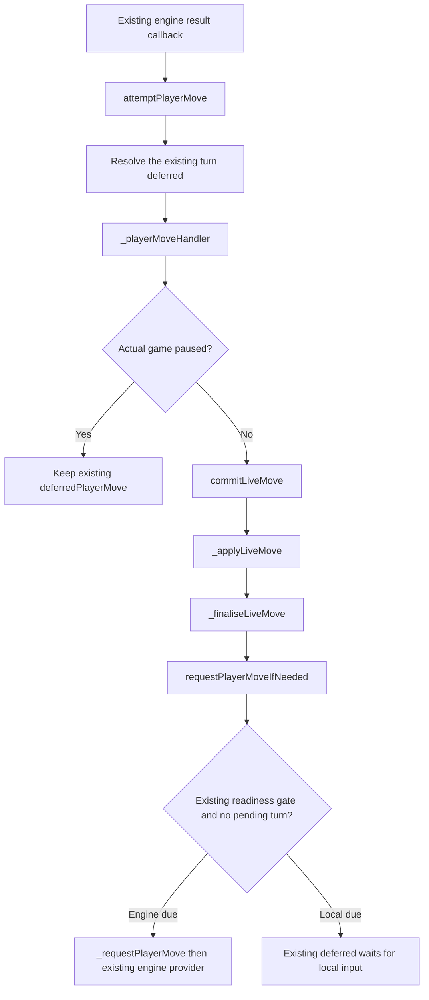

# Background analysis function-flow plan

Approved for implementation on 22 October 2026 by "looks fine implement". BA-Q4 was then resolved explicitly: allow analysis moves/history while actual play remains paused. This prerequisite is implemented through existing APIs and data; premoves remain a separate later change.

The [function flow for all 40 scenarios](BackgroundAnalysisScenarioFlow.md) describes the existing call chains, branch conditions and ownership boundaries. The approval includes paused entry, paused exploratory input and Manual-only restored pause ownership. Tests were revised and run red before production development; current verification is recorded at the end of this document.

## Scope and constraints

Explicit Analyse uses the currently selected canonical position while the actual clock and actual turns continue. Reviewing history also permits background actual progression. Exit selects the latest live position and does not pause, resume, replay or restart actual play.

A pre-existing Manual/Menu pause no longer blocks explicit Analyse entry: the user explicitly changed that policy on 21 October. Entry and Exit preserve actual clock/pause ownership and do not deliver held output; only the owning Resume releases actual play. [Q-PLAY-003](questions/play/Q-PLAY-003-PausedAnalysisEntry.md) records the reason this needed a decision, the prior design rules, the user's instruction and the confirmed permission for exploratory moves/history while paused.

Existing design constraints checked for this flow:

- [State model](HighLevel/state_model.md#pausing-and-interruptions): keep one authoritative `GameState` and existing actual pause ownership. Its prior paused-entry restriction is superseded by Q-PLAY-003; explicit paused exploration/history is also permitted.
- [Control panel](LowLevel/Architecture/Presentation/Components/GameControlPanel.md#mode-matrix): extend the prior Resume-only paused surface to expose the existing Analyse action. Preserve the existing props/events and an explicit Resume action; do not Resume actual play merely to enter analysis.
- [Gameplay/control flows](LowLevel/ProcessFlows/GameplayAndControl.md#scn-ctrl-04---enterexit-in-game-analysis-mode): the old entry pause assertion was deliberate product policy, now explicitly changed. Remove that entry guard, not the actual-commit pause gate.
- [Game data](LowLevel/Architecture/DataInterface/Game.md): path reference identity already expresses following live versus independent analysis. Reuse that ownership rather than introducing fields or replacing the model.
- [Accepted variation policy](questions/analysis/Q-ANALYSIS-002-VariationRetention.md): prune only the existing current-move case; preserve historical branches. The user's audit clarification confirms that a branch left behind by background progression remains history, without Exit/navigation cleanup.

The user's newer [background-play decision](questions/play/Q-PLAY-001-LiveProgressDuringAnalysis.md) overrides the older rules that Analyse itself freezes the clock/actual turn, entry uses the latest live node, and Exit resumes play. The later Q-PLAY-003 decision additionally allows entry during a genuine pause, without resuming actual play. Reconcile affected older design/flow descriptions with the approved scope, without changing unrelated contracts.

Keep every existing store/service/composable method name, signature and return shape, component prop/event, enum, canonical/runtime model field and saved schema. In particular:

- No new readiness method such as `isActualTurnReadyForMove`: reuse `isLiveTurnReadyForMove`.
- No new `historyReview` control-mode value or component prop: derive review from the existing state and paths in GameView.
- No `retainedAnalysisParents`, analysis-session registry, new turn driver, replacement promise scheme or queue in this prerequisite.
- No `pruneAnalysisMoves` service API. Keep existing pruning, with the narrow protection described below.
- No new engine, clock, history, serialization or persistence workflow. Use existing data and explicit actions.

The only intended new code is small local condition changes and, if necessary, a private helper to avoid repeating a condition. A helper must not be returned from a composable or added to a service/store API.

## Existing data determines the behaviour

| Existing data | Meaning in this plan |
| --- | --- |
| `game.livePath`, live node/position | Actual play and side due |
| `game.renderedPath`, rendered node/position | Selected canonical position; never a premove projection |
| Shared rendered/live path reference | Selected board follows actual play |
| Separate rendered path reference | Selected position is independent, even if both arrays currently contain the same indices |
| `Live*Turn` / `Paused*Turn` | Ordinary gameplay or review, with the actual side encoded; a different selected node alone does not enable analysis input |
| `LiveAnalysisFrom*` / `PausedLiveAnalysisFrom*` | Explicit Analyse, including separate actual and selected colours; paused variants represent genuine pauses |
| Existing `pauseReasons` | Manual/Menu ownership, including reconstructed Manual ownership for old paused saves |
| Existing pending turn/deferred output | One actual turn and its existing delivery/cancellation path |

Do not introduce another flag to distinguish review. `gameState` identifies explicit analysis; path identity identifies whether selection follows actual play. Path-value equality remains useful for comparing positions, but must not reattach an explicitly independent board.

## Function flow

### 1. Enter Analyse on the selected move

```text
Existing Analyse event in GameView
  -> gamesStore.enterInGameAnalysis(game)
  -> GameMoveComposable.enterInGameAnalysis(game)
       isPausedState(game.gameState)             // retain actual pause status
       getLivePosition(game)                     // actual position remains owned
       getRenderedNode/getRenderedPosition(game) // currently selected canonical move
       genPosition(selectedPosition, [])         // independent canonical copy
       setRenderedPath(game, copied selected path, selected cache)
       getLiveAnalysisState(actual colour, selected colour, existing pause status)
       _publishRenderedPosition(game, false)
```

Remove the entry pause assertion and accept both ordinary live and paused-live states. Remove the call to `pauseGame(..., PauseReason.Analysis)`. Do not clear/rearm the existing actual turn, change pause reasons or mutate the clock snapshot. Entering from an earlier selected node uses that node, not the newest live position. Entry at equal path values still creates independent selection/cache ownership. Paused entry uses the existing paused-analysis state; actual readiness remains false and deferred output stays held.

Within the existing GameView event action, cancel unfinished PV playback before changing mode and clear obsolete pending rewrite confirmation. Use the current actions and `playback.cancel()`; add no component event or store action. In the private `renderedBoard` cache, compare existing explicit-analysis/input permission and result phase alongside game/node/FEN: an equal-node/equal-FEN ownership change must reset input, while an actual-colour/score change behind unchanged analysis must not. Reuse the existing Chessboard position-prop reset. This is local projection/input ownership, not a new game-model field or observer.

Keep the existing paused GameControlPanel mode and Resume action. GameView composes one contextual Analyse/Exit action beside it in the controls region, selected from existing game state and calling existing actions. Reuse global button classes; add no mode, prop/event or CSS. Board/PV/history remain enabled in explicit paused analysis under BA-Q4. Do not prioritise the analysis panel mode over paused mode and hide Resume; derive analysis input permission separately from that panel mode.

### 2. Enter a board move or select a PV

```text
Existing board/PV event
  -> GameView._requestMoves / _applyMoves
       validate against canonical rendered position
       use existing owned PV playback where appropriate
  -> gamesStore.makeMove(game, move)
  -> GameMoveComposable.makeMove(game, move)
       assertMoveAllowed             // explicit paused exploration follows BA-Q4
       explicit ongoing Analyse?     _commitLiveAnalysisMove(...)
       genuinely paused actual input? reject before actual mutation
       confirmed actual history move? existing rewrite policy
       ordinary following-live turn? attemptPlayerMove(...)
       ordinary review input?        require Analyse for exploration
       non-live study/result?        _commitStandaloneAnalysisMove(...)
```

Test the explicit-analysis branch before the historical-rewrite branch. Selecting a historical anchor and pressing Analyse must not make the next exploratory move rewrite actual play merely because that anchor is a prefix of `livePath`.

Keep `_commitLiveAnalysisMove -> _advanceRenderedAnalysisBranch -> applyMove/addAnalysisMove/setRenderedPath -> _publishRenderedPosition`. It changes selected analysis only. It does not settle the actual pending turn, alter the actual clock or update the actual result.

History selection alone must not enable analysis input. Keep `controlMode = 'live'` for ordinary live-game review and the existing Analyse button. **BA-Q2 resolved:** retain move/PV-first-move submission into the existing rewrite confirmation when Takeback is allowed; otherwise require explicit Analyse. The user confirmed this policy during the audit. This does not add a new component mode, route, button or store API. Do not replace the existing confirmation with a new Continue action or disable its documented input path.

In GameView, `_requestMoves -> pendingContinuation -> _confirmContinuation -> _applyMoves` is the existing confirmation flow. Skip it for explicit analysis; otherwise a historical anchor still opens an actual-rewrite modal before the store's corrected dispatcher can run. Recheck selected game/node, ordinary context, ongoing result and Takeback permission before confirming. `_commitHistoryRewriteMove` drains the old actual turn before replacing its selectors; if that settlement already ended actual play, it cannot revive it. Preserve played continuation as a variation and restart the historical clock snapshot from now. Handle this branch before ordinary-live submission because review shares the ordinary-live state family.

### 3. Actual engine reply and successor turn



Keep this call chain and its current promise/abort ownership. Do not replace it with a driver or add another result callback.

Change the **existing** `isLiveTurnReadyForMove(game)` predicate to recognise an ongoing actual live game in either unpaused ordinary-live or explicit-analysis states. Remove rendered/live equality from actual readiness. It must remain false for real paused states, ended games and games without an actual live path.

Reuse that predicate in `requestPlayerMoveIfNeeded` and `flushDeferredPlayerMove`, retaining duplicate-turn prevention. An engine result therefore commits during analysis/review, and `_finaliseLiveMove` can request the successor without waiting for Exit.

Consumers of this existing predicate must remain coherent: actual-game controls shown during ordinary review act on the actual game/side, never on a historical side. Use `getLivePosition` in existing draw/action code where it currently reads selected side. Do not introduce a second public predicate just to preserve a view-specific condition.

Actual-turn readiness is not permission for every user action. Keep the ordinary-live family restriction in the existing `assertOngoingLiveAction` so widening readiness does not accidentally allow Resign/Draw from explicit analysis. Keep the existing control visibility and genuine-pause restrictions; Takeback retains its separately confirmed actual-game policy.

### 4. Commit an actual move without moving the selected board

Within the current `commitLiveMove -> _applyLiveMove -> _finaliseLiveMove` chain:

1. Keep actual timeout reconciliation and existing move, clock, history and recorded-analysis application.
2. Determine whether selection follows actual play from the **shared path reference**, not equal path values.
3. If following live, preserve the existing shared-path/cache update and selected-position refresh.
4. Otherwise preserve the selected path, node and board. Publish actual history/clock changes through the existing unchanged-selection publication path.
5. Preserve the existing explicit-analysis state family when updating the actual colour; ordinary review stays ordinary-live state. A background commit does not implicitly enter Analyse.
6. Call existing runtime registration and turn-request functions as today.

`GamePositionComposable.getRenderedPosition/getLivePosition` must alias caches only for a shared path reference. `hydrateGame` restores that shared reference for ordinary following-live data, but keeps it separate for explicit-analysis states even at equal-valued paths. These are condition changes inside existing functions, with no new position API.

`GameAnalysisComposable.refreshAnalysisForGame` continues evaluating the selected canonical board. `captureMoveAnalysis` keeps its existing position-provenance check so unrelated selected evaluations are not recorded on background actual moves. No engine service/API change is planned.

### 5. Protect the viewed branch and preserve existing history retention

`commitLiveMove` currently calls `pruneFutureMoves(parentNode)` whenever the actual parent has children. Add the existing-data condition: do not call it if the current rendered path is a descendant that the call would remove. Use the already available `isPathPrefix`/node data.

Outside that protected case, keep the existing prune unchanged. Do not add a domain method, change its signature/contract, or record a deferred-pruning registry.

**BA-Q1 resolved by the user:** "the only time it prunes is when the branch comes from your own current move. So it keeps the branch just as before. it's still a history review". Background progression makes the older anchor historical; retain its branch under existing history rules.

If analysis exits before actual play passes its current-move parent, keep the existing behaviour: variation remains after Exit, and the next real move from that same current parent triggers existing pruning. If background actual play has already passed the anchor, keep the branch as history through Exit, branch switching, navigation and save/restore. Do not add delayed cleanup or a new pruning boundary.

This needs only the narrow existing commit-time pruning guard, not a cleanup registry/helper/API. Preserve actual mainline, recorded output and unrelated historical/rewrite branches. Do not run `pruneFutureMoves` on an older ancestor after actual children have advanced from it. Analysis branches are still distinct from actual-move analysis records, and premoves remain outside the tree.

### 6. Exit Analyse or return to live

```text
Existing Exit analysis event
  -> cancel existing unfinished playback at the view boundary
  -> gamesStore.exitInGameAnalysis(game)
  -> existing _returnToLiveNode(game) selection path
       getLiveNode/getLivePosition(game)         // latest actual state
       setRenderedPath(game, game.livePath, live cache)
       ongoing paused? getPausedState(actual colour)
       ongoing unpaused? getLiveState(actual colour)
       terminal? getAnalysisState(final selected colour), preserve result
       _publishRenderedPosition(game, selected position changed)
       only if ongoing/unpaused: requestPlayerMoveIfNeeded(game)
```

Reuse `_returnToLiveNode` privately rather than maintaining a separate selection implementation in Exit. Keep its existing signature. Its current body is not pause-safe: it always chooses `Live*Turn` and requests a turn. Change that existing body to preserve real paused state and terminal results before reusing it. Entry/Exit must not produce a live state while a genuine pause owner remains.

Remove Analysis-driven clock resume and Exit-driven deferred flush. The existing actual turn has already been progressing, or genuine `resumeGame` owns the pending flush. Exit cannot replay a reply, apply another increment or start a second search.

### 7. Real pause, resume and timeout

Keep the current APIs and flow:

```text
pauseGame(game, Manual/Menu)
  -> existing clock pause, owner set, corresponding paused state

resumeGame(game, that owner)
  -> remove that owner
  -> if any owner remains: return
  -> existing clock resume, corresponding unpaused state
  -> existing flushDeferredPlayerMove
  -> existing requestPlayerMoveIfNeeded

syncClock(game, now)
  -> existing expiry check
  -> clearPlayerTurnRuntime
  -> existing timeout result/clock settlement
```

The final resume must flush/request in explicit-analysis states too, using the existing readiness predicate. Pausing/resuming ordinary review reads the **actual** side from `getLivePosition`, not the selected historical side. Timeout already supports unpaused live-analysis states; verify it with explicit timestamps rather than redesigning the time service.

Keep deferred-output delivery exclusively at the final real Resume boundary. The existing `flushDeferredPlayerMove` clears its held slot before checking readiness; calling it on entry, Exit or non-final owner removal would discard the reply. The existing `resumeGame` flush/request block also excludes analysis and must include eligible unpaused analysis. [The paused-entry breakage audit](questions/play/Q-PLAY-003-PausedAnalysisEntry.md#breakage-audit-after-the-user-requested-a-compatibility-check) records four confirmed isolated source probes and the exact affected functions.

Keep the `PauseReason.Analysis` enum for compatibility; normal Analyse entry/exit simply stop using it. Actual moves, result actions and actual Takeback retain their genuine-pause restriction. Explicit Analyse entry is now permitted and preserves that pause. `canExploreAnalysis` recognises explicit analysis without an Analysis-only pause; it also permits paused analysis moves/history under BA-Q4. Do not turn a broader exploration predicate into permission for actual paused actions.

In particular, `takeBack` currently uses `assertExplorationAllowed`, so allowing paused exploration would also allow actual Takeback unless its existing entry guard retains the genuine-pause restriction. Fix that action's internal condition rather than weakening the global pause assertion. The existing paused control mode supplies Resume, and one contextual view action supplies Analyse/Exit without an API change. Under BA-Q4, an actual Pause need not cancel a still-valid analysis prefix. Actual pause ownership remains unchanged.

### 8. Actual Takeback, restore and invalidation

- `takeBack -> clearPlayerTurnRuntime -> existing engine stop -> MoveHistoryService.takeBack -> setRenderedPath/setLivePath -> startClock -> refresh/request` stays the flow. Remove only re-adding Analysis pause. Existing Takeback selects the surviving actual node, so no special selection registry is needed when a branch is removed.
- `insertGame -> _hydrateAndInsertGame -> hydrateGame -> runtime registration -> requestPlayerMoveIfNeeded` stays the restore flow. Old paused-analysis records reconstruct explicit Manual ownership, remain paused until Resume and keep an independent selected board; add no schema migration/API.
- Resignation, accepted draw, reassignment and root replacement keep their existing cancellation actions. Analysis selection is not a replacement actual-turn owner.

### 9. Navigate, finish or invalidate while analysis is selected

`navigateToNode` must capture whether explicit analysis is active before changing selection. Ordinary review retains the ordinary-live family with the **actual** side; navigation within explicit analysis retains its analysis family with actual/selected colours. History navigation must not implicitly enter Analyse. The existing deliberate return-to-live path restores shared references and exits explicit exploration. Stale, pruned and foreign nodes retain the existing membership rejection without mutation.

In GameView, reuse `playback.cancel()` at existing user/lifecycle boundaries before allowed Takeback, confirmed rewrite, mode switch, root replacement and route teardown. A genuine Pause leaves a valid explicit analysis prefix eligible. Before each delayed prefix commit, check the existing owned operation, selected path, result/mode and current input permission. A background terminal result changes that context, so the loop stops before another commit even when no user action could call `playback.cancel()` immediately. Keep computation pure; add no gameplay watcher or store-to-view callback API. Ordinary background replies/scores preserve unchanged analysis input; node/mode/permission changes reset selection, drag and promotion through the existing prop boundary.

For actual mate/draw/timeout while exploring, stop actual clock/work once and preserve the recorded result. Keep the selected surviving board for non-live review; a mating exploratory line alone never ends actual play. Existing return-to-live/review actions may select the final actual node but cannot restore an ongoing state. A stale Exit/Resume/provider callback cannot add a move, increment or search after termination. Preserve existing board-edit restrictions for every workspace that retains a live path.

Scope correction: `_closeTab -> UiStateStore.closeTab -> router.push` changes session/UI state only. It does not dispose GamesStore actual work, and no public dispose/remove-game method exists. Do not invent one in this prerequisite or assert that view teardown stops actual play. Existing reassignment/result/Takeback/setup/resource teardown actions retain their real cancellation owners; future queue-on-close cancellation remains in the premove plan.

### Audit decisions and remaining clarification

These product choices are approved:

| ID | Question | User decision |
| --- | --- | --- |
| BA-Q1 | After actual play passes the parent of a viewed branch, should leaving it trigger cleanup? | No. Pruning applies only to the existing own-current-move case. Once the anchor is historical, keep the branch as history; no Exit/navigation cleanup. |
| BA-Q2 | Outside explicit Analyse, should a move from history still open the existing actual-rewrite confirmation when Takeback is allowed? | Yes. Preserve that confirmation; require explicit Analyse for exploration when Takeback is disabled. |
| BA-Q3 | May explicit Analyse open while the actual game is Manual/Menu paused? | Yes. The user explicitly allowed entry. Preserve actual clock/pause reasons; Entry/Exit cannot Resume. [Reason and old contract conflict](questions/play/Q-PLAY-003-PausedAnalysisEntry.md#why-this-required-a-decision) are recorded. |
| BA-Q4 | May analysis moves and history navigation work while the actual pause remains? | Resolved on 22 October: allow explicit analysis moves/history while actual play stays paused. Actual moves, clocks, Takeback and result actions retain the genuine pause guard. |

## Intended change surface

| Existing owner | Minimal internal change |
| --- | --- |
| GameMoveComposable | Remove automatic analysis pause/resume and entry's pause guard; preserve paused status on entry/Exit, order existing move branches, keep selected anchor/state family, guard destructive prune, reuse return-to-live and remove Takeback re-pause |
| GamePositionComposable | Reference-based live following; preserve explicit-analysis independence on hydration |
| GameStatusComposable | Reuse existing readiness/exploration predicates; actual-side reads for actual controls |
| GamePlayerTurnComposable | Use the existing readiness predicate for arm/flush; retain current deferred, callback and abort/drain |
| GameClockComposable | Allow existing final-resume flush during analysis; use actual side during review |
| GameWorkspaceComposable | Reconstruct real Manual ownership for older paused analysis |
| GameView / existing control template | Expose paused Analyse through existing events while retaining Resume and unchanged props/events; route analysis before rewrite confirmation, enforce the confirmed input policies and show actual turn/clock state. Paused exploratory input follows the confirmed BA-Q4 permission |

No changes are planned to the GamesStore facade/dependency interfaces, component prop/event declarations, Game/Move contracts, MoveHistoryService API, engine interfaces, clock algorithms, saved schema, audit policy or CSS. Do not use tests to justify expanding that surface.

## Unit tests before development

After this plan is approved:

1. Keep the retained data-driven unit specifications; revise implementation-specific assertions to the API constraint below.
2. Run them against unchanged production code and record meaningful failures.
3. Change only the existing function bodies described above.
4. Rerun focused unit tests, then affected unit suites, code audit/build and relevant existing browser checks. Adjust obsolete Analysis-pause expectations intentionally.

Use existing `createGame/insertGame/makeMove/navigateToNode/enterInGameAnalysis/exitInGameAnalysis/pauseGame/resumeGame/takeBack/syncClock` actions, real board/history/time functions and controlled external engine callbacks. Test game data/observable effects, not a proposed new helper. Use explicit timestamps; no random delays or unbounded engine loops.

| Group | Required observable result |
| --- | --- |
| Entry/exit clocks | Actual clock snapshot is not paused/resumed by Analyse/Exit |
| Genuine pause boundary | Manual/Menu pause permits Analyse entry without actual clock/owner changes; actual output stays deferred and only final Resume restarts actual play. Analysis-engine management remains available; explicit paused exploratory input is allowed |
| Equal-path entry | A reply before the first exploratory move advances actual play without mutating selected canonical board |
| Multiple actual turns | Successive controlled engine turns proceed while analysis/review remains selected |
| Explicit input | Selecting history alone permits no analysis input; existing Analyse starts on that selected canonical move |
| Independent moves | Exploratory board/PV moves change selected branch only; actual commits change actual branch only |
| Pruning/history | Protect the selected branch during actual commits; keep the existing current-move pruning and retain historical branches through Exit/navigation/save, without a new pruning API |
| Real pauses | Layered Manual/Menu ownership retains output and final resume flushes exactly once while still analysing |
| Timeout | Actual clock expires during exploration; Exit cannot revive it |
| Actual Takeback | Existing live move-count policy, cancellation and surviving selection remain correct without Analysis re-pause |
| Restore/invalidation | Saved pause requires Resume; old cancelled output cannot mutate replacement ownership |
| Provenance | Analysis engines use canonical selected position; actual move recording cannot copy unrelated output |
| Hotseat | Current side owns input after handoff; no premove implementation or previous-side entitlement |

The retained tests were kept at the user's request. **Expectations revised before production development:** domain tests calling nonexistent `pruneAnalysisMoves` must assert approved branch behaviour through existing actions; mounted tests demanding a new `historyReview` mode must use existing modes and the confirmed rewrite/exploration policy. The retained active-branch case demands Exit cleanup; revise it to assert historical retention per BA-Q1. Test-first does not mean forcing an unapproved API or obsolete assertion into production.

## Scenario coverage audit

The earlier group table was not thorough scenario coverage: it omitted exact branches, timing orders and regression ownership. The following 40 acceptance cases incorporate BA-Q1/BA-Q2 and the later BA-Q3 paused-entry decision. BA-Q4 permits explicit exploratory input during genuine pauses. The matrix states acceptance requirements; the verification record below distinguishes executed lanes.

Test lanes: **U** means data-driven store/position unit tests with real move/history/clock rules and held external engine callbacks; **V** means mounted view/board tests for routing, ownership and controls; **J** means affected existing journey/browser regressions after the unit-first implementation. A row may need both U and V because a correct store transition does not prove that the UI can reach it safely.

### Entry, selection and actual progression

| ID | Fixture and actions | Required observation | Function flow / test lane |
| --- | --- | --- | --- |
| BA-01 | Analyse on the current live node, then repeat the request | Independent canonical selection; no move, pause reason, clock transition or replacement actual search; repeated entry is harmless | [function flow](BackgroundAnalysisScenarioFlow.md#ba-01) / U,V |
| BA-02 | Enter with equal-valued paths; release an engine reply before any exploratory move | Actual path/position advances once; selected path/board remains the entry snapshot, including cache identity ownership | [function flow](BackgroundAnalysisScenarioFlow.md#ba-02) / U,V |
| BA-03 | Select an earlier node; Analyse with Takeback allowed and disabled; play board/PV moves | Entry anchors that canonical node; explicit input explores only, without rewrite confirmation or actual-turn settlement | [function flow](BackgroundAnalysisScenarioFlow.md#ba-03) / U,V |
| BA-04 | Review root, mainline, sibling and nested nodes while actual play advances | Navigation does not enter Analyse or move the selected board on background commits; actual clock/side remains correct | [function flow](BackgroundAnalysisScenarioFlow.md#ba-04) / U,V,J |
| BA-05 | Navigate within explicit analysis, then deliberately return to the live node | Analysis navigation preserves its explicit family; return selects latest actual node and restores shared path/position references | [function flow](BackgroundAnalysisScenarioFlow.md#ba-05) / U,V |
| BA-06 | Exit before a held reply, after its commit, repeatedly and while Manual/Menu paused | Latest actual position appears; no repeated reply, clock resume, increment or duplicate search. Paused Exit remains paused and cannot arm an actual turn | [function flow](BackgroundAnalysisScenarioFlow.md#ba-06) / U,V |
| BA-07 | Deliver a navigation request for a pruned/detached node or another hydrated tree | Existing membership rejection leaves selected/actual tree, clock, result and searches unchanged | [function flow](BackgroundAnalysisScenarioFlow.md#ba-07) / U,J |
| BA-08 | Ordinary live move while following live; navigate away and return before another move | One actual node/path append; following-live aliases advance together; independent review detaches and explicit return reattaches | [function flow](BackgroundAnalysisScenarioFlow.md#ba-08) / U |
| BA-09 | Alternate exploratory moves for both colours with a controlled actual reply | Each move changes only its owned board/branch; current analysis side and actual due side may differ without result/clock contamination | [function flow](BackgroundAnalysisScenarioFlow.md#ba-09) / U |
| BA-10 | Human-engine game reaches the human's actual turn while Analyse stays displayed, with no premove feature | Actual human turn waits and its clock runs; exploratory input never plays that actual human move or starts another actual engine turn | [function flow](BackgroundAnalysisScenarioFlow.md#ba-10) / U |
| BA-11 | Release at least three successive engine-engine replies during Analyse and ordinary review | Actual turns/searches proceed without Exit, exactly one commit per reply; selected canonical board remains fixed | [function flow](BackgroundAnalysisScenarioFlow.md#ba-11) / U |
| BA-12 | Background actual commits with zero/+2 increment; selected and actual colours differ | Charge the actual mover and add each increment once; selected moves and entry/exit add none. Turn/status and clocks use actual data | [function flow](BackgroundAnalysisScenarioFlow.md#ba-12) / U,V |

### Genuine pauses, navigation and endings

| ID | Fixture and actions | Required observation | Function flow / test lane |
| --- | --- | --- | --- |
| BA-13 | Request Analyse while Manual/Menu paused, through controls and direct existing action; test both an in-flight provider and already-held reply; then Exit | Entry succeeds with independent canonical board and paused-analysis state. Entry/Exit preserve actual pause reasons, clock snapshot and pending/held ownership; no flush, lost reply, duplicate search or implicit Resume | [function flow](BackgroundAnalysisScenarioFlow.md#ba-13) / U,V,J |
| BA-14 | Pause an existing analysis session or enter while paused; deliver actual/evaluation output and try exploratory input | Actual output stays deferred with no move/increment until real resume; evaluation/management remain available. Board/PV/history remain enabled in explicit paused analysis under the confirmed BA-Q4 decision | [function flow](BackgroundAnalysisScenarioFlow.md#ba-14) / U,V,J |
| BA-15 | Layer Manual and Menu; remove each in both orders; repeat pause/removal; finally Resume while still analysing | Non-final removal preserves pause and held reply. Final removal flushes once and arms one successor without Exit/repeated engine work. An available Resume control remains reachable during paused analysis | [function flow](BackgroundAnalysisScenarioFlow.md#ba-15) / U,V,J |
| BA-16 | Visit Save/Settings/Custom flow with auto-pause enabled/disabled, including cancellation and untimed play | Apply only existing clock policy; Menu return removes only its own owner. No synthetic Analysis owner or stray pause in an untimed game | [function flow](BackgroundAnalysisScenarioFlow.md#ba-16) / U,V,J |
| BA-17 | Switch games/routes and return while actual work runs; then close its session tab | Per-game actual work and analysis selection remain isolated. Tab switching alone does not pause; route teardown cancels view playback. Closing a tab changes UI/session state, not actual-game disposal | [function flow](BackgroundAnalysisScenarioFlow.md#ba-17) / U,V,J |
| BA-18 | Review a position with the opposite side to actual play; Pause/Resume and use an allowed actual control | Pause/resume the actual side; allowed ordinary-review actions target actual play, not the historical side | [function flow](BackgroundAnalysisScenarioFlow.md#ba-18) / U,V |
| BA-19 | During analysis reach exact expiry; race a reply, two sync calls and focus/route events | One timeout settlement, no post-deadline move/increment/search; preserve final result and stopped clock through stale Exit/Resume/output | [function flow](BackgroundAnalysisScenarioFlow.md#ba-19) / U,J |
| BA-20 | Actual reply causes mate, stalemate or other rule-resolved draw while another node is selected | Actual result and stopped history clock are correct once; selected surviving review remains usable; return cannot revive live state | [function flow](BackgroundAnalysisScenarioFlow.md#ba-20) / U,V,J |
| BA-21 | A mating/drawing exploratory line is reached while actual game is ongoing; try Resign/Draw directly in explicit analysis | Exploration never adjudicates actual play. Widened actual readiness does not bypass existing user-action state restrictions | [function flow](BackgroundAnalysisScenarioFlow.md#ba-21) / U,V |

### Structural actions and unfinished input

| ID | Fixture and actions | Required observation | Function flow / test lane |
| --- | --- | --- | --- |
| BA-22 | Takeback with analysis far from live; engine thinking/replied, both human colours, no prior human move and policy disabled | Apply actual move-count/permission policy; drain old actual work, restore surviving live node/clock and cancel invalid selection/playback. No Analysis re-pause | [function flow](BackgroundAnalysisScenarioFlow.md#ba-22) / U,V,J |
| BA-23 | Request history continuation; cancel or confirm; change selected node before confirming; separately move in explicit analysis | Preserve confirmed actual rewrite and played variation. Cancel/stale selection does not rewrite; explicit analysis never opens that modal. With Takeback disabled, exploration requires Analyse | [function flow](BackgroundAnalysisScenarioFlow.md#ba-23) / U,V,J |
| BA-24 | Reassign due engine to Local/another engine/none, plus an unchanged assignment, with old output held | Real replacement cancels its old owner; none follows existing conversion-to-study rules. No-op preserves work. Late old output cannot move replacement or another game | [function flow](BackgroundAnalysisScenarioFlow.md#ba-24) / U,J |
| BA-25 | Replace setup/root or tear down an assigned engine resource with prior output/playback pending | Existing action/resource owners cancel captured work; old callbacks cannot mutate replacement tree/root/selection. Do not equate session-tab close with game disposal | [function flow](BackgroundAnalysisScenarioFlow.md#ba-25) / U,V,J |
| BA-26 | Select a PV whose first move is legal but a later move is stale; then select a valid prefix | Reject the whole stale prefix before its first commit; valid prefix applies only its selected analysis moves with existing interval/cancellation ownership | [function flow](BackgroundAnalysisScenarioFlow.md#ba-26) / U,V,J |
| BA-27 | During delayed analysis playback, Exit, Pause, navigate, Takeback, confirm rewrite, change route or receive an actual terminal result | Explicit boundaries cancel/settle old work; each delayed step checks owned context before committing. Pause retains valid explicit exploratory input; no delayed move crosses into a replacement result/mode | [function flow](BackgroundAnalysisScenarioFlow.md#ba-27) / V,J |
| BA-28 | Begin drag/promotion; change input mode/selected node or advance following-live play. Separately publish a score/background reply behind unchanged analysis | Changed selected input context cancels unfinished input; irrelevant publications preserve it. No late move crosses the boundary; no canonical move occurs before promotion choice | [function flow](BackgroundAnalysisScenarioFlow.md#ba-28) / V,J |
| BA-29 | Toggle existing score-only/move-enabled preference; select suggestions in live, review and explicit analysis | Respect existing preference; live submits one actual move, explicit analysis plays a prefix, review follows BA-Q2. No opponent-turn premove input is added here | [function flow](BackgroundAnalysisScenarioFlow.md#ba-29) / U,V,J |
| BA-30 | Hotseat handoff; deliver old side's retained click/drop/analysis request, then fresh due-side input/Analyse | Stale input context cannot act for the previous side; fresh input belongs to actual side. No queue or old-side entitlement; do not invent person authentication | [function flow](BackgroundAnalysisScenarioFlow.md#ba-30) / U,V,J |

### Persistence, evaluation and pruning

| ID | Fixture and actions | Required observation | Function flow / test lane |
| --- | --- | --- | --- |
| BA-31 | Save/export while actual and selected boards differ, then load/import | Canonical tree, both selectors, actual clocks/result and configured seats round-trip; runtime callbacks/deferred output are absent. No premove projection or queue exists in this prerequisite | [function flow](BackgroundAnalysisScenarioFlow.md#ba-31) / U,J |
| BA-32 | Restore running analysis at equal and divergent paths, and ordinary following-live play; exercise analysis-resume preference | Explicit analysis restores independent caches, ordinary live restores aliases; actual timing uses persisted timestamps and arms at most one eligible actual turn. Seat restoration follows existing preference | [function flow](BackgroundAnalysisScenarioFlow.md#ba-32) / U,J |
| BA-33 | Load old paused analysis; visit/cancel menus, then explicitly Resume without Exit | Reconstruct Manual ownership, preserve saved time and selection; Menu cannot clear Manual. Final Resume advances actual play while analysis remains selected, with no extra Analysis owner | [function flow](BackgroundAnalysisScenarioFlow.md#ba-33) / U,J |
| BA-34 | Actual move with matching selected-parent output, no output, or output from a different selected position; then save/reload/prune | Capture available matching output once as an independent actual-move record; never copy unrelated selected output or record exploratory moves; existing records survive | [function flow](BackgroundAnalysisScenarioFlow.md#ba-34) / U,J |
| BA-35 | Two selected-analysis seats stream independently; background actual reply, explicit refresh, failure/retry/removal of one seat | Analysis remains bound to canonical selected board; unchanged selection does not restart both seats. Existing independent failure/cancellation and actual-provider ownership remain intact | [function flow](BackgroundAnalysisScenarioFlow.md#ba-35) / U,J |
| BA-36 | Illegal/stale board move, retained old analysis callback and old actual callback after cancellation | No partial mutation or cross-position evaluation. Existing legality/provenance/cancellation boundaries reject invalid work without a new counter or turn driver | [function flow](BackgroundAnalysisScenarioFlow.md#ba-36) / U,V,J |
| BA-37 | Explore from live parent, then append actual sibling moves while selected branch remains viewed | Do not prune active selected descendants; actual mainline, selected path/node/board and shared tree identity remain consistent | [function flow](BackgroundAnalysisScenarioFlow.md#ba-37) / U |
| BA-38 | Explore from latest node, Exit before actual play advances, then make the next real move from that parent | Preserve existing temporary variation after Exit and prune it at that next actual commit, preserving played records | [function flow](BackgroundAnalysisScenarioFlow.md#ba-38) / U,J |
| BA-39 | Actual play passes protected parent; leave/switch the selected branch, Exit and save/reload | Retain the branch as history with its original node/continuation intact. No delayed Exit/navigation cleanup or retrospective pruning of the older parent | [function flow](BackgroundAnalysisScenarioFlow.md#ba-39) / U |
| BA-40 | Existing current-move pruning, Takeback or rewrite near nested/history variations; resolve all paths after save/reload | Preserve actual played mainline, records and unrelated historical/rewrite branches. Child-index/path/cache updates stay valid; no blanket ancestor prune deletes actual play | [function flow](BackgroundAnalysisScenarioFlow.md#ba-40) / U,J |

Use focused parameterisation, not every combination: both actual colours; human-engine, local-local and engine-engine where relevant; timed/untimed and zero/nonzero increment; live/historical/alternate/equal-path selections. Gesture cases cover both orientations and the existing pointer/keyboard/touch paths. The engine-engine fixture proves repeated automatic turns without inventing human premoves. In human-engine analysis with no queue, the actual human turn correctly waits (BA-10).

### Traceability to existing scenarios and journeys

Read with [high-level scenarios](HighLevel/scenarios.md), [analysis flows](LowLevel/ProcessFlows/AnalysisAndSetup.md), [gameplay/control flows](LowLevel/ProcessFlows/GameplayAndControl.md) and the existing journey reviews. Historical passing evidence proves the old policy only; rewrite obsolete assertions intentionally rather than counting them as background-play acceptance.

| Existing contract | Cases and regression ownership |
| --- | --- |
| SCN-CTRL-04; SCN-HIST-01 | BA-01–08, BA-13, BA-17; [History JRN-01/05/07/09](../journeys/definitions/history/ScenarioReview.md) |
| SCN-HIST-02/03; analysis/history suggestion routing | BA-03, BA-23, BA-29; [History JRN-02/03/04](../journeys/definitions/history/ScenarioReview.md). BA-Q2 resolves the changed explicit-entry boundary; preserve actual rewrite confirmation |
| SCN-HIST-04; accepted variation scope | BA-34, BA-37–40; [History JRN-06](../journeys/definitions/history/ScenarioReview.md), [Q-ANALYSIS-002](questions/analysis/Q-ANALYSIS-002-VariationRetention.md). BA-Q1 confirms no new cleanup for a branch whose anchor became historical |
| SCN-MOVE-01/02/03; SCN-CTRL-05 | BA-08–12, BA-20/21, BA-26–30, BA-36; existing Play/Promotion journeys and [History JRN-08](../journeys/definitions/history/ScenarioReview.md). Board edit remains blocked whenever a live path exists |
| SCN-TIME-01–05 | BA-12–19, BA-32/33; [Clocks JRN-01–12](../journeys/definitions/clocks/ScenarioReview.md). Replace Analysis-freeze/restore-owner assertions; retain real-pause, exact-expiry and tab policies |
| SCN-CTRL-01/02/03; SCN-ENGINE-03; setup/root transitions | BA-18–25; [Engine races JRN-01/03/04/08](../journeys/definitions/engine-races/ScenarioReview.md), existing Takeback/PlayerAssignment/Setup regressions. Preserve mode permissions, actual cancellation and no-op policy |
| SCN-ANALYSIS-01–05 | BA-03, BA-14, BA-26–29, BA-34–36; [Analysis JRN-01–12](../journeys/definitions/analysis/ScenarioReview.md), [Engine races JRN-05–08](../journeys/definitions/engine-races/ScenarioReview.md). Prefix ownership and seat independence remain existing contracts |
| SCN-SESSION-02; Save/Load/Import/Export | BA-07, BA-31–34, BA-40; existing Saved/session/clock-restore regressions. Preserve canonical schema and running-versus-paused restore policy |
| Old Analysis-freeze race | BA-02/06/09–12, BA-14/15, BA-37–39 replace [Engine races JRN-02](../journeys/definitions/engine-races/ScenarioReview.md)'s freeze expectation. Keep its real-pause/cancellation neighbours |

### Boundary with the premove scenario matrix

The [25 parent scenarios](questions/play/Q-PLAY-002-PremoveAnalysisConflicts.md#concrete-scenario-matrix) combine analysis and future queue behaviour. This prerequisite covers only the analysis portion:

| Parent scenarios | Analysis prerequisite / deferred portion |
| --- | --- |
| PRE-S05–08, S12, S23/24 | BA-01–12/19 prove canonical entry, clocks, independence, Exit and actual scheduling. PRE-S08's interleaved queued human commits await premoves; engine-engine replies prove this prerequisite's automatic successor loop |
| PRE-S10/11/19 | BA-04, BA-13–18/27 prove genuine pause, review/navigation and per-game isolation. Queue editing/consumption/preservation remain deferred |
| PRE-S13/14/17/18/21 | BA-20–30/36 prove actual rewrite/Takeback, hotseat, input cancellation, endings and structural cancellation. Queue clearing and queue-specific promotion/gestures remain deferred |
| PRE-S16 | BA-37–40 cover active-branch protection, existing current-move pruning and retained historical branches; no new Exit/navigation cleanup |
| PRE-S22/25 | BA-31–36 cover canonical engine/recording/save isolation and old paused restore. Queue projection/runtime exclusion and empty restored queue remain premove checks |
| PRE-S01–04, S09, S15, S20 | Queue drawing, consumption/undo, special projections, whole-queue invalidation and off-turn append routing belong to the later premove plan; this prerequisite is not their acceptance |

### Implementation and verification

The approved implementation keeps the GamesStore facade, composable interfaces, component props/events, enums, model and saved schema unchanged. No watcher, CSS rule, engine driver or premove queue was added. Current-node cache lookup also follows shared live selection after an actual move, preventing analysis from attaching to a stale parent.

Tests-first evidence:

- Revised state/position/history/view specifications before production: **26 failures, 39 passes** against the old behaviour.
- State implementation with the new mounted UI cases, before presentation changes: **5 failures, 63 passes**; state/position/history suites passed while the UI still failed.
- Focused implementation check: **68/68 passed**. A further shared-node-cache assertion reproduced the journey failure before its one-line lookup fix.
- Final full unit/integration run: **593 passed, 0 failed** (`vitest run --maxWorkers=4`).
- Browser validation: **111 distinct cases passed across the initial run and targeted corrections/reruns**. This includes all 96 affected Analysis/History/Clock/engine-race cases, plus promotion cancellation, player reassignment, setup start and actual Takeback boundaries. The initial browser run had seven obsolete-policy failures; revised assertions and controlled-Date fixtures were rerun successfully. Reports remain under ignored `test-results/BackgroundAnalysis*BrowserResults.json` and the final `JourneyResults.json`.
- `npm run build` passed, including `check:code`, TypeScript checking and the production bundle. `git diff --check` passed.
- Browser journeys use the scripted UCI process boundary; native engine/ponder validation was not run.

Coverage owners: BA-01-12 and BA-18-23 use BackgroundAnalysis/GamesStore/GameStatus/GamePosition specifications plus History/Clock/engine-race journeys. BA-13-17 and BA-32/33 use paused-entry, held-output, layered-owner, restored-analysis and mounted-control tests. BA-24/25/30 use existing reassignment/setup and cancelled-turn regressions. BA-26-29/36 use full-prefix validation, retained-input callbacks, mode/route cancellation, terminal playback and promotion regressions. BA-31/34/35 use serialization, actual-move recording and independent engine-seat journeys. BA-37-40 use active sibling retention, current-parent pruning, Takeback/rewrite and save-shaped hydration checks. The detailed matrix remains the scenario contract; passing a suite does not establish native-platform acceptance.

Executed evidence supporting the scenario matrix (these are assertion owners, not a claim that every possible timing/gesture combination was exhaustively run):

| Cases | Concrete executed assertions/regressions |
| --- | --- |
| BA-01/02 | BackgroundAnalysis: unchanged entry/Exit clock and equal-path board isolation; GamePosition: independent cache reads/hydration |
| BA-03/04 | BackgroundAnalysis: explicit selected historical move and successive actual turns behind review; GameView: historical analysis bypasses rewrite; History Navigation/BranchPolicy journeys |
| BA-05/06 | GamesStore: rendered-path detach/re-alias and navigation states; BackgroundAnalysis: current actual return without replay plus paused Exit; JRN-RACE-02 both release orders |
| BA-07/08 | GamePosition: detached/foreign membership rejection, shared live append and cache lookup; GamesStore history navigation and History Persistence journeys |
| BA-09/10/11 | BackgroundAnalysis: protected active branch, successive actual engine turns, exploratory-only moves and waiting local turn; JRN-HIST-05 both-colour exploration |
| BA-12 | BackgroundAnalysis layered-pause increment assertions; Clock Increment zero/+2 cases; timed PV and actual-status browser assertions |
| BA-13/14/15 | BackgroundAnalysis Manual/Menu in-flight/already-held entry and layered Resume; GameView paused controls/full prefix; JRN-HIST-05 paused variant, JRN-HIST-07, JRN-RACE-01 |
| BA-16/17 | GameView route/modal ownership and route playback cancellation; Clock Menu/Interruption, Analysis Suggestion game-switch and session unit regressions |
| BA-18/19 | BackgroundAnalysis actual-side draw/timeout; GamesStore pause-family and timeout tests; Clock Timeout/Interruption and JRN-RACE-04 result cancellation |
| BA-20/21 | BackgroundAnalysis actual mating reply and exploratory mate; GameView terminal prefix stop; GamesStore retained terminal results |
| BA-22/23 | BackgroundAnalysis actual Takeback/history rewrite cancellation; GamesStore live-node/count policy; GameView confirmation; five JRN-PLAY-07 and History Rewrite browser cases |
| BA-24/25 | GamesStore reassignment cancellation and replaced-setup disposal; JRN-RACE-03; four PlayerAssignment and two Setup Start browser cases |
| BA-26/27 | GameView full prefixes, Exit cancellation and terminal stop; UiFollowUp stale-prefix rejection; Analysis Suggestion mode/game-switch journeys |
| BA-28/29/30 | GameView retained callback, context replacement and selected-input preservation; BackgroundAnalysis stale hotseat side; four promotion cancellation cases and Analysis score-only/suggestion routing |
| BA-31/32/33 | GamePosition explicit restore vs ordinary aliases; GamesStore eligible runtime restore; BackgroundAnalysis save-shaped historical retention/Manual-only restore; History/Analysis/Clock Persistence journeys |
| BA-34/35/36 | Recording integration and History Pruning browser records; BackgroundAnalysis unrelated-evaluation exclusion; GamesStore stopped/removed seat callbacks; Analysis Streaming/Management and engine-race cleanup |
| BA-37/38/39/40 | BackgroundAnalysis active sibling, next-actual-move prune and historical hydration; MoveHistoryService retention tests; History Pruning/Rewrite/Persistence and actual Takeback journeys |

Premoves remain deferred to their separate plan.
