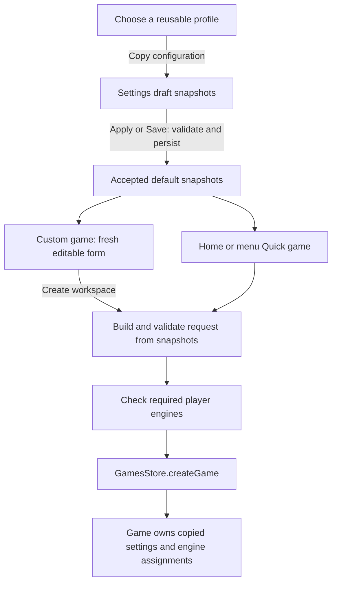

# Quick game defaults: UI and data design

Status: implementation authorised on 25 October 2026 after the snapshot/request-model revisions. Implementation and verification are recorded below.

The agreed scope is to make saved game defaults cover the options available in Custom game, and make Quick game honour those defaults. The user requested snapshots: selecting a profile copies its configuration into the defaults, which are independent of later profile changes. The unpublished app does not need compatibility with previous settings files, so this design replaces the unfinished defaults format directly.

## Original gaps

[SettingsView](../src/views/SettingsView.vue) offers a name, player types and clock fields. It cannot choose a particular engine profile, analysis engines, takeback policy, live-analysis moves or the Custom clock option.

[QuickGameComposable](../src/composables/QuickGameComposable.ts) uses the accepted name and clock but hard-codes local players, no analysis engines, enabled takebacks and disabled live-analysis moves. [GameCreationModal](../src/components/modals/GameCreationModal.vue) exposes those options but initialises from the settings draft and chooses the first engine for an engine-type default. A stored custom clock without a preset currently opens as Untimed.

## Settings UI

Keep the existing Gameplay route, settings shell, navigation and Save/Apply/Cancel actions. Expand Quick game defaults into clearly labelled groups, followed by the existing Move behaviour section.

Use the caption: **Used by Quick game and as the starting options for Custom game.**

```text
Gameplay

Quick game defaults
Used by Quick game and as the starting options for Custom game.

Game
  Game name                 [New Game                         ]

Players
  Randomly assign colours   [off]
  White                     [Local player                    v]
  Black                     [Keep Stockfish                  v]
  Starts a game with White playing locally against Stockfish.
                                           [Use free analysis]

Time & assistance
  Clock                     [Custom                          v]
  Minutes                   [5          ]
  Increment (seconds)       [2          ]
  Allow takebacks           [on ]
  Show live analysis moves  [off]

Analysis engines                                      1 of 4
  [Keep Stockfish (saved configuration) v]            [Remove]
  [Choose engine profile               v]        [Add engine]
  [Manage engine profiles]

Move behaviour
  After exploring history   [Return to live position         v]

                                      [Cancel] [Save] [Apply]
```

| Control | Options and behaviour |
| --- | --- |
| Game name | Required, trimmed text; the same name seed for both creation flows. |
| White / Black | Unassigned (free analysis), Local player, Keep the saved engine when present, then named engine profiles. Choosing a profile copies its configuration into that seat. |
| Resulting workspace | A computed sentence explains whether the selections start a live game or free analysis. An unassigned seat produces free analysis, preserving the other selected seat. |
| Use free analysis | An explicit action sets both seats to Unassigned. Choosing Local or a profile later edits that seat normally. |
| Clock | Untimed, Bullet (1+0), Blitz (5+0), Rapid (10+0), Classical (30+0), Custom. |
| Timed values | Custom exposes Minutes and Increment (seconds). Named presets show their duration and increment as text. Untimed hides both inputs. |
| Allow takebacks | Matches the existing Custom game option. |
| Show live analysis moves | Editable for live games. Free analysis shows the explanation that analysis moves are available there; the stored live-game preference is retained for a later live selection. |
| Analysis engines | Zero to four saved engine rows. Each row offers Keep its saved configuration, replace it from a current profile, or Remove. Add engine copies a chosen profile into a new row and is disabled at four. |
| Manage engine profiles | Navigate to the existing Engines category and preserve the settings draft. An empty inventory offers this action with explanatory text. |

The initial values remain New Game, Local/Local, Untimed, takebacks enabled, live-analysis moves disabled and no analysis engines. The bundled Stockfish profile remains in the initial engine inventory and is available in each profile selector.

Desktop uses the existing label/control columns. Mobile stacks labels and controls, keeps the two clock inputs readable and wraps engine names. Use the existing global field, section, toggle and button styles; any necessary shared variants belong in the global CSS modules. Headings and captions use the same spacing as the other settings sections.

Custom game retains its Play a game / Free analysis control. Both unassigned defaults open it in Free analysis; one unassigned default opens the player form with that seat explicitly unassigned. The explicit Free analysis button still omits both players when building a request. These choices have the same effective results as Settings without needing a persisted workspace-mode flag.

Existing engine snapshots appear as Keep choices even after their source profiles have changed or been deleted. Label current inventory choices as Use profile: followed by the profile name, so an explicit replacement is distinguishable from keeping a saved configuration with the same name. Each saved row can show its path and custom-option summary. Keep the existing snapshots when opening either form; opening a selector never refreshes them from the inventory.

## Saved data

Use the existing [ICreateGameRequest](../src/contracts/Game.ts) and `createGameRequestSchema` directly as the source for saved defaults. The request already contains the name, optional player snapshots, analysis engine snapshots, clock and assistance options. Replace the current `ISettingsGameDefaults` interface with a derived property type; do not maintain a second list of those fields.

```ts
// Within ISettingsSnapshot:
gameDefaults: Omit<ICreateGameRequest, 'rootPosition'>;
// Reuse the creation schema for persisted defaults:
const settingsGameDefaultsSchema = createGameRequestSchema.omit({ rootPosition: true });
```

`rootPosition` belongs to an individual creation request or prepared board. Omit it from settings so these defaults use the normal starting position. The existing optional assistance flags remain optional in the request contract; built-in defaults supply `allowTakeback: true` and `showLiveAnalysisMoves: false`. Use those same effective values when a flag is omitted, and write the form's explicit values on Apply/Save. Settings-specific refinements can enforce the rules below on the derived schema without copying its field definitions.

An example configured for a local player against the bundled engine:

```json
{
  "gameDefaults": {
    "name": "Evening game",
    "whitePlayer": { "colour": "white", "type": "local", "displayName": "White" },
    "blackPlayer": {
      "colour": "black",
      "type": "engine",
      "displayName": "Stockfish",
      "assignedEngine": {
        "displayName": "Stockfish",
        "clientType": "uciWorker",
        "entryPath": "engines/stockfish/stockfish-19-lite-single.js",
        "options": {}
      }
    },
    "timeControl": { "initialMs": 300000, "incrementMs": 2000 },
    "allowTakeback": true,
    "showLiveAnalysisMoves": false,
    "analysisEngineProfiles": [{
      "id": "stockfish",
      "displayName": "Stockfish",
      "clientType": "uciWorker",
      "entryPath": "engines/stockfish/stockfish-19-lite-single.js",
      "options": {}
    }]
  }
}
```

An omitted player property means Unassigned, as in the existing game creation request. Local players contain their colour, type and display name. Engine players also contain the complete `assignedEngine` configuration. No new player-selection model is needed.

The request's existing `analysisEngineProfiles: IEngineRecord[]` already stores complete profile objects: display name, client type, path and options, plus their copied ID. Keep this existing type. The copied ID is inert data in the snapshot; creation never resolves it against the inventory or uses it to refresh saved configuration. Profile edits/deletion therefore remain independent. No creation-request or analysis-seat input type change is needed.

The reused creation schema already includes `playerSchema` and engine profile schemas that persist configuration and omit runtime fields. Although in-memory player interfaces permit `$` runtime state, defaults contain none. Do not store processes, availability, callbacks, analysis results or subscriptions.

The same configured profile may be copied into both players and into analysis. Those are separate snapshots and retain independent engine instances when a game is created. Analysis snapshot names are unique within their own list, matching existing game analysis selection rules, and their saved order is preserved. Replacing a row may keep its name; adding another row with a name already present requires a differently named profile.

The data records effective player assignments. Two present players produce a live game; either omitted player produces an analysis workspace. There is no second stored mode that could disagree with those assignments.

The optional `randomiseColours` creation flag defaults to false. When enabled, the input slots represent Player 1 and Player 2 and their selector labels change accordingly. Keep canonical White/Black colours in these saved input snapshots so shared validation still applies. The store draws once when creating a live game or starting a prepared board, copies each participant and its engine configuration to the resolved colour, and gives built-in local names stable Player 1/Player 2 labels. Each Quick game draws again. Saving settings, rendering the form, validating engines and creating free analysis do not draw. Games persist only the resulting player assignments, so restore never randomises them. The checkbox is disabled while either input is unassigned.

### Clock representation

Reuse `ITimeControl`; Custom is a UI choice represented by an omitted `preset`.

| Choice | Canonical value |
| --- | --- |
| Untimed | `{ preset: 'untimed', incrementMs: 0 }` |
| Bullet | `{ preset: 'bullet', initialMs: 60000, incrementMs: 0 }` |
| Blitz | `{ preset: 'blitz', initialMs: 300000, incrementMs: 0 }` |
| Rapid | `{ preset: 'rapid', initialMs: 600000, incrementMs: 0 }` |
| Classical | `{ preset: 'classical', initialMs: 1800000, incrementMs: 0 }` |
| Custom 5+2 | `{ initialMs: 300000, incrementMs: 2000 }` |

Selecting a named preset replaces the clock object with its canonical value. Selecting Custom retains an existing timed value, or starts at 10+0 when coming from Untimed. Selecting Untimed removes `initialMs` and sets the increment to zero. These are explicit input actions.

The UI converts minutes and seconds to milliseconds at the form boundary. An absent `preset` with a valid `initialMs` reopens as Custom in both forms. Named presets are not arbitrary labels attached to edited durations.

## Validation and snapshot behaviour

Use the same creation validation rules in Settings and Custom game. Validate embedded configuration independently from the current profile inventory and check runtime readiness at creation.

| Boundary | Rules |
| --- | --- |
| Document shape | Non-empty trimmed name; optional players validated with the existing player schema; player colour agrees with its seat. Engine snapshots contain display name, client type, entry path and scalar option values. Analysis snapshots have unique names and are limited to four. Runtime fields are excluded. |
| Clock | Untimed has no initial time and zero increment. Timed controls require a finite duration between 1 and 600 minutes, represented in whole milliseconds, and an integer increment from 0 to 300 seconds. Named presets must match their canonical values. |
| Settings Apply/Save | Validate the saved player/engine configuration and require non-empty engine entry paths. Show field errors and retain the draft on failure. Inventory membership is unnecessary. Checking settings does not start engine processes. |
| Creation | Build the request from accepted snapshots. Invalid defaults produce an actionable error before creation. Required live player engines undergo the existing readiness check using their saved configuration before the game is inserted. |

Editing, renaming, copying or deleting a reusable profile leaves saved defaults unchanged. Profile deletion needs no defaults-reference guard. To update defaults, explicitly choose the current profile again for the desired player or analysis row. A deleted profile's saved configuration remains usable while its engine files are available.

An unavailable engine is reported against the saved configuration and can be repaired by explicitly choosing a replacement profile. Preserve its snapshot for review and retry. Never substitute another profile by inventory order or display name. Runtime readiness is checked at creation, since a stored path alone does not prove that an engine can run.

Package removal must also inspect accepted and draft default player/analysis snapshots, alongside its existing configured-profile and open-game checks. Project these engine paths into the existing `IEnginePackageUsage` values with labels such as Game defaults: Black and Game defaults analysis: Stockfish. The existing removal queue reads current usage again before deletion. Replacing only the draft snapshot does not release a path still used by accepted defaults; apply that replacement before removing the package. Native executable file management retains its existing behaviour.

Applying changed defaults affects future creations. Existing games retain their own player, analysis and gameplay snapshots.

## Ownership and creation flows



| Owner | Planned responsibility |
| --- | --- |
| `contracts/Settings.ts` | Derive the `gameDefaults` type and schema from `ICreateGameRequest` / `createGameRequestSchema`, excluding `rootPosition`. Remove the separate defaults interface. |
| `UserSettingService` | Built-in defaults, snapshot/clock validation and persistence. Both settings serialisation paths use the same schema and exclude runtime state. |
| `SettingsStore` | Draft ownership, accepted snapshot and dirty state. Extend draft copying for player objects, assigned engines/options, the clock and every analysis snapshot/options map. |
| `SettingsView` | Render saved snapshots and computed field errors. Offer draft inventory profiles as explicit copy sources, including profiles added in the same unsaved settings edit. |
| Shared pure creation utilities | Canonical preset values, clock/form mapping, snapshot validation and copying a chosen profile into a player or analysis configuration. Utilities do not access stores or start work. |
| `QuickGameComposable` | Read one accepted snapshot, build a request, check required player engines and create through its existing operation owner. Home and menu keep using this same action. |
| `GameCreationModal` | Initialise a fresh local form from accepted settings, allow overrides and submit through its existing modal action. An unsaved settings draft must not initialise a game. |
| `GamesStore` | Retain current insertion, copied assignment, clock, analysis and player-turn ownership. |
| `EnginePackageDetailsView` | Include accepted/draft default snapshots in its existing package-usage projection and queued removal check. |

Profile IDs may identify an option during a user selection event. Copy the complete profile for an analysis choice, or its player payload for a player choice. A copied analysis profile ID stays inert; it is not resolved again during creation. Keep saved snapshots as their own form choices even when current inventory names match. Build the request from the form's captured snapshot values before the first readiness await and retain analysis order.

Copy mutable configuration at the existing ownership boundaries: accepted defaults to a settings draft or Custom form, and a creation request to its game. The copied engine options and clock must not share mutable state with their source. Reuse existing schema/copy boundaries where they already provide that isolation; do not add cloning on ordinary reads.

Quick game passes the saved players, clock, analysis snapshots and both assistance preferences to `ICreateGameRequest`. For a resulting free-analysis workspace, set the effective `showLiveAnalysisMoves` to true, matching the existing Custom flow, while retaining the user's live-game preference in defaults. Optional analysis engine startup failures retain the existing per-engine error behaviour. A required player-engine readiness failure prevents creation and offers **Edit game defaults**.

Reuse `EngineRuntimeService.getOptions` for required-player readiness, passing the saved configuration with the existing temporary seat identifier required by that API. This identifier is not a persisted profile reference. Its temporary session owns its cleanup. Quick creation awaits each issued readiness call and checks its operation signal before insertion; route cancellation prevents later creation/navigation while issued readiness work settles. Keep duplicate-start prevention and the current post-insertion cancellation semantics. No runtime lifecycle change, watcher or invalidation counter is needed.

Preserve the existing start-from-setup precedence: the prepared game supplies its name, assistance preferences and analysis assignments; both player selectors initially use Local, and the clock is seeded from accepted creation defaults. Workspace and Unassigned choices remain hidden for that flow. The prepared board and history retain their existing preservation rules. This change does not expand start-from-setup behaviour or reapply creation defaults when restoring saved games.

## Persistence boundary

Replace the unpublished settings format directly and retain the current `schemaVersion: 1`. No migration, legacy-field aliases or automatic old-player-type conversion is planned. Previous settings that fail the new shape use the existing warning/default fallback and are rewritten only by an explicit Apply, Save or Reset action. Saved game, session and layout formats retain their existing contracts.

The [current settings contract](HighLevel/settings_contract.md) must be updated with the new `gameDefaults` properties when implementation is authorised. Its current statements that takebacks and live-analysis moves are exclusively per-game settings will distinguish creation defaults from the copied values persisted in each game.

## Implementation sequence

1. Update the settings contract, derive defaults from the existing creation request/schema and update the built-in snapshot together. Update settings serialisation and fixtures to the new format without compatibility branches.
2. Add shared pure clock/snapshot mappings and validation; extend SettingsStore draft isolation for the new nested values. Retain the existing creation request and analysis input contracts.
3. Expand Gameplay controls with Keep/copy/replace actions and include default snapshot paths in package removal checks. Use existing global styles and explicit events.
4. Initialise Custom game from accepted defaults, handle stored Custom clocks correctly and retain prepared-board ownership.
5. Wire every default into the shared Quick game action and required-player readiness checks, retaining cancellation and error handling.
6. Update the affected architecture documents, settings overview and journey expectations. Run the focused verification below and the required code audit/build checks.

## Verification for implementation

| Coverage | Required evidence |
| --- | --- |
| Settings and serialisation | New fields round-trip without runtime state; invalid shapes/clocks/duplicate analysis names are rejected; failed Apply retains accepted state and the full draft; discard isolates players, engine options, clock and analysis arrays. |
| UI and clocks | Preset values and units match in Settings/Custom; Custom survives save/reload; Untimed clears timed data; invalid inputs block the action; profile names wrap and controls remain usable at desktop/mobile widths. |
| Default parity | Home Quick game, menu Quick game and an unchanged Custom form produce equivalent creation options for local/local, local/engine, engine/engine, one unassigned seat and both unassigned seats. |
| Engines | Readiness failure creates no game/tab; profile edits/deletion leave defaults and future creations unchanged; explicit replacement updates only the chosen snapshot; package removal checks accepted/draft default paths even after profile deletion; one profile can supply independent player/analysis snapshots. |
| Ownership | Unsaved drafts never seed creation; repeated Quick clicks create once; leaving during readiness prevents insertion; late completion cannot navigate back; existing games and prepared positions retain their owned values. |

Update [Defaults.spec.ts](../e2e/journeys/fresh/Defaults.spec.ts), [ComponentOwnership.spec.ts](../journeys/__tests__/cleanup/ComponentOwnership.spec.ts) and their scenario review, which currently assert that Quick game ignores player defaults. Extend the existing settings/domain/modal coverage where it verifies the changed boundaries. Include a normal-browser check using bundled Stockfish for both a default engine opponent and default analysis; scripted journeys alone do not verify a real engine launch.

Run `npm run check:code`, the focused unit/application tests, `npm run build` and the affected browser journeys after changes.

## Implementation and verification record

Implemented on 25 October 2026. Settings derive their defaults type/schema from the creation request, persist complete snapshots and initialise both creation paths from accepted values. Shared player, clock and analysis fields use explicit copy/replace actions. Package usage includes accepted and draft default snapshots. Settings draft copying retains property order for the existing JSON dirty comparison while isolating nested configuration.

- The complete unit/application suite passed **929/929 tests across 105 files**. After the browser-discovered dirty-state correction, **27/27 focused settings, modal and mounted creation tests** passed again.
- **47 distinct affected browser cases passed across the initial run and focused reruns.** The initial run passed 42 and exposed five failures. Explicit accessible names fixed the analysis selector issue; preserving default property order fixed unchanged settings appearing dirty. Tests were updated for the explicit Use profile option labels and awaited Save navigation before reload. Three affected cases then passed; the remaining two new cases passed after allowing real engine thinking time and checking mobile free-analysis state through its saved game rather than a desktop-only heading.
- Normal Chromium verified a real bundled Stockfish opponent and analysis from saved defaults after deleting the reusable profile and reloading, package-removal protection after profile deletion, and saved Custom/free-analysis defaults on mobile. Existing fresh, setup, settings assignment and complete-session cases are included in the 47-case total.
- `npm run build` passed after the production fixes, including TypeScript and the required code audit. Desktop/mobile review screenshots showed no horizontal overflow. Modified-document links and `git diff --check` passed.

Focused logs and screenshots are under ignored `node_modules/.cache/codex/QuickGameDefaults/`; the initial browser log is `test-results/QuickGameDefaultsBrowser.log`. Native NW.js runtime acceptance was not run for this change.

### Random player colours

Implemented the additional new-game option on 25 October 2026 in Settings, Custom game and start-from-setup. The existing creation requests carry optional `randomiseColours`; the game workspace resolves the draw before starting players and persists only the assigned snapshots.

- **98/98 focused unit/application tests across seven files passed**, covering both draws, unchanged fixed/partial assignments, settings persistence, modal submission and prepared-board side-to-move preservation.
- **12/12 browser checks passed**, including real Stockfish on either colour, saved defaults after reload, a fresh draw through menu Quick game, stable saved/restored assignments, existing creation and setup recovery.
- Production build, TypeScript, `check:code` and `git diff --check` passed. Browser/build logs are under ignored `node_modules/.cache/codex/RandomColours/`. Native NW.js runtime acceptance was not run.
