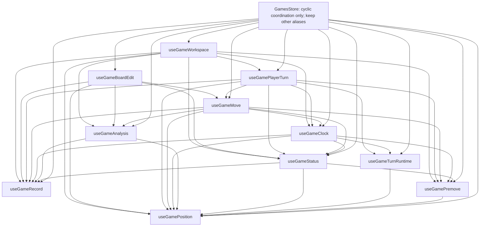

# Store dependency restructuring plan

Implemented on 23 October 2026 against source baseline `f981553` (the original plan used `e8795fa`). **Status: implemented; verification recorded below.** Move only the orchestration that causes circular dependencies or implementation-hiding callback injection. Keep the other implementations and public aliases in their existing composables.

## Scope rule

The presence of a public GamesStore API is not a reason to relocate its implementation. Default to `create/read/edit/analysis` logic remaining with its existing composable. GamesStore coordinates a function only when its necessary call into a higher composable would form a cycle.

The [full function flows](StoreDependencyFunctionFlows.md) distinguish a retained alias, a small boundary wrapper, a moved coordinator and the implementation that stays below it. They retain explicit calls, arguments, branches and await points.

Follow [AGENTS.md](../AGENTS.md), [cleanup ownership](ArchivedPlans/CodeCleanupPlan.md), the implemented [premove contract](ArchivedPlans/PreMovePlan%28ToDo%29.md), [raw move boundary](ArchivedPlans/RawMoveSubmissionDesign.md) and [canonical reactive state](ArchivedPlans/WorkspaceRevisionRemovalPlan.md). No alternate resolver, watcher, invalidation counter, action lane, generic event bus or unrelated engine/disposal redesign.

## Call wiring only; preserve the real flow

**This pass changes only the code around function calls needed to repair dependency navigation. The real execution flow must not change.** Pass whole composable objects, replace injected function calls with concrete `owner.method(...)` calls, and relocate only the minimum coordination needed to break a dependency cycle. Keep the existing implementation in its composable otherwise.

- Preserve the same branch conditions, validation, early returns, arguments and object identities; invoke the same underlying operations the same number of times and in the same order.
- Preserve state mutations, timestamp capture points, clock updates, premove handling and the order of all side effects.
- Preserve synchronous work versus background work, every existing await boundary, public results, promise completion/rejection, cancellation, retry and error propagation. A helper split must not add an await or defer work that currently happens synchronously.
- Preserve subscription eligibility, refresh/unsubscribe triggers and resource lifetimes, including focus listeners and engine/analysis ownership. Moving the registration owner does not permit changing when registration happens.
- Do not combine this pass with bug fixes, extra guards, flow simplification, optimisations or lifecycle hardening. Record any such finding separately.

For each changed boundary, compare the current-source and proposed call traces. After accounting for owner names and forwarding helpers, the meaningful operations, branches, effects and async boundaries must match. Internal flags may carry an existing decision across a split; they must not introduce a new decision or public result. Keep existing behavioural test expectations unchanged.

**This constraint takes precedence over every proposed graph, split and flow tree below.** If a proposed cut cannot preserve the existing trace, revise that cut before implementation. In particular, the earlier proposal to retain focus listeners through pauses/results is withdrawn; focus wiring must preserve the existing refresh operation at each original call boundary.

## The dependency cuts and why each is needed

| Troubled edge | Minimal cut | What stays in its composable |
| --- | --- | --- |
| `move.makeMove -> playerTurn`, while player turn commits through move | Put intake routing in GamesStore. | Move resolution, all canonical commits, selected analysis commits and root replacement stay in move. |
| History rewrite/takeback cancel and restart player turn | Move their await/cancel/restart coordination to GamesStore. | Accepted history mutation and rewind/tree/snapshot work stay in move. |
| `move._finaliseLiveMove -> playerTurn.requestPlayerMoveIfNeeded` | The existing player-turn handler/held-output path requests its successor after lower commitment. | Finalise/result/analysis/premove mutation stays in move. Same Deferred/handler/controller mechanism. |
| Return-to-live helper requests player turn | Remove only that upward tail; thin navigation/exit wrappers perform it when the retained lower method reports returning to live. | Navigation, enter/exit analysis, caches, state projection and `_returnToLiveNode` stay in move. `enterInGameAnalysis` keeps its alias. |
| `clock.syncClock -> playerTurn`; player turn reaches clock through move | Extract the existing clear/abort/await functions into lower `turnRuntime`, which depends only on position. Clock receives that whole object. | Sync, async settlement, its pending map, expiry query, snapshots and timeout finalisation stay in clock. |
| Resume flushes/restarts the higher player-turn driver | Only Resume gets a store wrapper for the existing guard/expiry/flush/restart calls. | Pause remains an alias; resume reason/clock/state mutation remains in clock. |
| `status.resign/acceptDraw -> playerTurn`, while player turn reads status | Store performs guard/await coordination; lower finaliser performs accepted result mutation. | All guards, fields, timestamps, ordinary draw offer/decline/withdraw implementations stay in status. |
| Focus registration previously reached a cyclic timeout coordinator | The lower cancellation owner makes `clock.syncClock` acyclic, so registration does not move. | Focus refresh and its callback stay in clock; every original action boundary, eligibility rule and unsubscribe/replacement lifetime stays intact. |
| Shared store functions are injected as handwritten callback signatures | Give existing timestamp/autosave and queue functions whole `record/premove` owners. | Preserve their existing bodies, counters, raw move references and call policy. Do not move unrelated feature implementations. |

`playerTurn.reassignPlayer` stays in playerTurn; preserve its registration refresh between timestamping and requesting the next turn. Its refresh now calls the whole clock object, and its clear operation calls the whole turnRuntime object. Board edit and all analysis commands likewise stay in their current composables.

## Complete whole-object dependency graph

Each dependency is a complete object typed from its factory's inferred `ReturnType`. The input container may remain an interface. Do not extract functions, introduce handwritten callable API properties, pass a whole store into a child, or conceal cycles using late setters/getters.

| Order | Object / factory | Direct private composable dependencies | Retained responsibility |
| --- | --- | --- | --- |
| 1 | `position` / `useGamePosition` | None | Unchanged position/path/cache/projection implementation. |
| 2 | `record` / `useGameRecord` | None | Existing timestamp/autosave bodies; preserve lazy saved-store lookup inside the queued save. |
| 3 | `premove` / `useGamePremove` | `position` | Existing shared queue clear, append and revalidation bodies. |
| 4 | `turnRuntime` / `useGameTurnRuntime` | `position` | Existing held-move clearing and abort/reject/await-handler functions; no turn driver dependency. |
| 5 | `status` / `useGameStatus` | `position, record, premove` | Guards, state/result fields, simple draw actions and synchronous result finalisers. |
| 6 | `analysis` / `useGameAnalysis` | `position, record` | Every analysis implementation; replace timestamp callback with record object. |
| 7 | `clock` / `useGameClock` | `position, status, record, premove, turnRuntime` | Clock calculations, timeout sync/settlement, focus registration, pause and resume state mutation. |
| 8 | `move` / `useGameMove` | `position, status, clock, analysis, record, premove` | Commits, analysis/navigation state and rewind mutation; no upward turn calls. |
| 9 | `playerTurn` / `useGamePlayerTurn` | `position, status, record, premove, move, clock, turnRuntime` | Existing Deferred/handler/controller mechanism, synchronous successor continuation and reassignment. |
| 10 | `boardEdit` / `useGameBoardEdit` | `position, status, analysis, move, record` | All seven board-edit actions and shared implementation. |
| 11 | `workspace` / `useGameWorkspace` | `position, status, clock, analysis, playerTurn, record, premove` | Unsplit construction, admission, setup, activation and reads; original registration boundaries. |



This graph has **37 private composable edges** and eleven root construction dependencies. Keeping an existing valid dependency is intentional; minimising the number of edges is not the objective. The lower chain `playerTurn -> move -> clock -> status` has no reverse call.

```ts
const position = useGamePosition();
const record = useGameRecord();
const premove = useGamePremove({ position });
const turnRuntime = useGameTurnRuntime({ position });
const status = useGameStatus({ position, record, premove });
const analysis = useGameAnalysis({ position, record });
const clock = useGameClock({ position, status, record, premove, turnRuntime });
const move = useGameMove({ position, status, clock, analysis, record, premove });
const playerTurn = useGamePlayerTurn({ position, status, record, premove, move, clock, turnRuntime });
const boardEdit = useGameBoardEdit({ position, status, analysis, move, record });
const workspace = useGameWorkspace({ position, status, clock, analysis, playerTurn, record, premove });
```

The three new private owners are `record`, `premove` and `turnRuntime`. The extra cancellation-only owner resolves the previously provisional focus cut without moving a registration call or introducing an async boundary. Do not add a control or move-commit composable. Factory APIs remain inferred; for example `GameMoveComposable = ReturnType<typeof useGameMove>`.

### Outbound dependencies

| Owner | Direct service/store boundaries |
| --- | --- |
| GamesStore | Existing explicit player-engine stop sites for takeback/scope disposal. |
| record | Existing lazy `useSavedGamesStore().saveGame` call inside the queued save; accepted settings for autosave interval. |
| premove / position | Existing MoveApplicationService and position/history projection boundaries. |
| status | Existing TimeControlService pause on live-rule/result finalisation. |
| analysis | Existing EngineRuntimeService analysis lifecycle. |
| clock | Existing TimeControlService calculations/snapshots and PlatformEventService focus registration. |
| move | Existing MoveApplicationService and MoveHistoryService commit/prune/rewind boundaries. |
| playerTurn | Existing engine readiness/delivery/runtime and old-engine stop on reassignment; existing pause calculation there. |
| boardEdit | Existing MoveApplicationService piece-edit operations. |
| workspace | Existing MoveHistoryService initial tree and UserSettingService restore policy. |

## Public API disposition

All 36 members stay compatible. **26 feature functions keep their composable aliases.** Four cyclic coordinators move to GamesStore; three APIs gain small wrappers while their core stays below. The two shared store APIs become direct aliases to their whole-object owners. `autosaveError` remains a state ref alias.

| Public member | Disposition | Execution flow |
| --- | --- | --- |
| `autosaveError` | Keep state ref alias to `record.autosaveError`. | [F02](StoreDependencyFunctionFlows.md#sdr-f02-recording-and-autosave) |
| `onAutosaveFailed` | Keep public API as a direct alias to its whole-object owner. | [F02](StoreDependencyFunctionFlows.md#sdr-f02-recording-and-autosave) |
| `createGame` | Keep alias; implementation stays in `workspace.createGame`. | [F17](StoreDependencyFunctionFlows.md#sdr-f17-workspace-create-insert-and-read) |
| `startGameFromSetup` | Keep alias; implementation stays in `workspace.startGameFromSetup`. | [F18](StoreDependencyFunctionFlows.md#sdr-f18-start-from-setup) |
| `insertGame` | Keep alias; implementation stays in `workspace.insertGame`. | [F17](StoreDependencyFunctionFlows.md#sdr-f17-workspace-create-insert-and-read) |
| `getGame` | Keep alias; implementation stays in `workspace.getGame`. | [F17](StoreDependencyFunctionFlows.md#sdr-f17-workspace-create-insert-and-read) |
| `listGames` | Keep alias; implementation stays in `workspace.listGames`. | [F17](StoreDependencyFunctionFlows.md#sdr-f17-workspace-create-insert-and-read) |
| `makeMove` | Move only cyclic orchestration to GamesStore; lower implementation retained. | [F10](StoreDependencyFunctionFlows.md#sdr-f10-public-move-intake) |
| `clearPremoves` | Keep public API as a direct alias to its whole-object owner. | [F05](StoreDependencyFunctionFlows.md#sdr-f05-premove-queue-operations) |
| `getTakeBackMoveCount` | Keep alias; implementation stays in `move.getTakeBackMoveCount`. | [F12](StoreDependencyFunctionFlows.md#sdr-f12-takeback) |
| `takeBack` | Move only cyclic orchestration to GamesStore; lower implementation retained. | [F12](StoreDependencyFunctionFlows.md#sdr-f12-takeback) |
| `navigateToNode` | Small GamesStore boundary wrapper; core stays in original composable. | [F13](StoreDependencyFunctionFlows.md#sdr-f13-navigation-and-analysis-mode) |
| `getVisibleAnalysis` | Keep alias; implementation stays in `analysis.getVisibleAnalysis`. | [F07](StoreDependencyFunctionFlows.md#sdr-f07-analysis-seat-lifecycle) |
| `syncClock` | Keep alias; implementation stays in `clock.syncClock`. | [F14](StoreDependencyFunctionFlows.md#sdr-f14-clock-control-and-focus-return) |
| `pauseGame` | Keep alias; implementation stays in `clock.pauseGame`. | [F14](StoreDependencyFunctionFlows.md#sdr-f14-clock-control-and-focus-return) |
| `resumeGame` | Small GamesStore boundary wrapper; core stays in original composable. | [F14](StoreDependencyFunctionFlows.md#sdr-f14-clock-control-and-focus-return) |
| `reassignPlayer` | Keep alias; implementation stays in `playerTurn.reassignPlayer`. | [F16](StoreDependencyFunctionFlows.md#sdr-f16-player-reassignment) |
| `addAnalysisEngine` | Keep alias; implementation stays in `analysis.addAnalysisEngine`. | [F07](StoreDependencyFunctionFlows.md#sdr-f07-analysis-seat-lifecycle) |
| `removeAnalysisEngine` | Keep alias; implementation stays in `analysis.removeAnalysisEngine`. | [F07](StoreDependencyFunctionFlows.md#sdr-f07-analysis-seat-lifecycle) |
| `refreshAnalysis` | Keep alias; implementation stays in `analysis.refreshAnalysis`. | [F07](StoreDependencyFunctionFlows.md#sdr-f07-analysis-seat-lifecycle) |
| `retryAnalysis` | Keep alias; implementation stays in `analysis.retryAnalysis`. | [F07](StoreDependencyFunctionFlows.md#sdr-f07-analysis-seat-lifecycle) |
| `stopAnalysis` | Keep alias; implementation stays in `analysis.stopAnalysis`. | [F07](StoreDependencyFunctionFlows.md#sdr-f07-analysis-seat-lifecycle) |
| `enterInGameAnalysis` | Keep alias; implementation stays in `move.enterInGameAnalysis`. | [F13](StoreDependencyFunctionFlows.md#sdr-f13-navigation-and-analysis-mode) |
| `exitInGameAnalysis` | Small GamesStore boundary wrapper; core stays in original composable. | [F13](StoreDependencyFunctionFlows.md#sdr-f13-navigation-and-analysis-mode) |
| `enterBoardEdit` | Keep alias; implementation stays in `boardEdit.enterBoardEdit`. | [F19](StoreDependencyFunctionFlows.md#sdr-f19-board-edit-actions) |
| `applyBoardEdit` | Keep alias; implementation stays in `boardEdit.applyBoardEdit`. | [F19](StoreDependencyFunctionFlows.md#sdr-f19-board-edit-actions) |
| `clearBoard` | Keep alias; implementation stays in `boardEdit.clearBoard`. | [F19](StoreDependencyFunctionFlows.md#sdr-f19-board-edit-actions) |
| `deleteChessPiece` | Keep alias; implementation stays in `boardEdit.deleteChessPiece`. | [F19](StoreDependencyFunctionFlows.md#sdr-f19-board-edit-actions) |
| `moveChessPiece` | Keep alias; implementation stays in `boardEdit.moveChessPiece`. | [F19](StoreDependencyFunctionFlows.md#sdr-f19-board-edit-actions) |
| `resetBoardToStartPosition` | Keep alias; implementation stays in `boardEdit.resetBoardToStartPosition`. | [F19](StoreDependencyFunctionFlows.md#sdr-f19-board-edit-actions) |
| `toggleChessPiece` | Keep alias; implementation stays in `boardEdit.toggleChessPiece`. | [F19](StoreDependencyFunctionFlows.md#sdr-f19-board-edit-actions) |
| `resignGame` | Move only cyclic orchestration to GamesStore; lower implementation retained. | [F15](StoreDependencyFunctionFlows.md#sdr-f15-result-and-draw-actions) |
| `offerDraw` | Keep alias; implementation stays in `status.offerDraw`. | [F15](StoreDependencyFunctionFlows.md#sdr-f15-result-and-draw-actions) |
| `acceptDrawOffer` | Move only cyclic orchestration to GamesStore; lower implementation retained. | [F15](StoreDependencyFunctionFlows.md#sdr-f15-result-and-draw-actions) |
| `declineDrawOffer` | Keep alias; implementation stays in `status.declineDrawOffer`. | [F15](StoreDependencyFunctionFlows.md#sdr-f15-result-and-draw-actions) |
| `withdrawDrawOffer` | Keep alias; implementation stays in `status.withdrawDrawOffer`. | [F15](StoreDependencyFunctionFlows.md#sdr-f15-result-and-draw-actions) |

Representative retained return entries are `offerDraw: status.offerDraw`, `reassignPlayer: playerTurn.reassignPlayer`, `enterInGameAnalysis: move.enterInGameAnalysis`, `getTakeBackMoveCount: move.getTakeBackMoveCount`, every analysis/board-edit alias, and workspace `getGame/listGames`. No pass-through GamesStore function is added to those APIs.

## Precise split contracts

- `move.commitHistoryMove(game, detailedMove, selectedPath, selectedNode, selectedPosition)` retains the existing accepted history mutation, including clock setup and non-pruning policy. Store owns only cancellation/revalidation/restart.
- `move.rewind(game, targetNode, count, hadLivePath)` retains tree/path/snapshot mutation and starts/returns its existing analysis-work promise; Store clears/stops first and requests next play before awaiting that promise.
- `move.navigateToNode/exitInGameAnalysis` retain their bodies and report whether they actually returned to live. Their store wrappers use that internal boolean to request eligible play and preserve the existing public void result. `enterInGameAnalysis` stays an alias.
- `clock.pauseGame(game, reason)` remains the original async implementation and public alias. Store Resume preserves the original guard, timestamp capture and expiry route, then synchronously calls `clock.resumeClockState(game, reason, timestamp)`; only an accepted readiness result leads to the original awaited flush and successor request.
- `status.finaliseResignation(game, colour)` and `status.finaliseDrawAgreement(game)` retain the existing accepted field/clock/queue/timestamp changes. Store's public coordinators guard and await the old handler before calling them, then refresh clock registration at the original position.
- Workspace `createGame/insertGame/startGameFromSetup` retain their complete implementations and aliases, including admission, registration refresh and activation. The provisional activation split is withdrawn because the lower cancellation owner removes its dependency problem.
- Keep `playerTurn.reassignPlayer` in place; replace its timestamp/queue callbacks with whole objects and preserve its registration refresh at the original position. No result/pause/engine-assignment logic migrates.

## Complete source-function disposition

All 144 existing named functions are accounted for below. A split row explicitly names both destinations; it does not mean the whole body moves. Private factories and new thin helpers are not counted as old functions.

| Current source | Existing functions | Retained owner / necessary split |
| --- | --- | --- |
| [GamesStore.ts](../src/state/GamesStore.ts) | `onAutosaveFailed`, `_moveCommitted`, `_timestampGame` | record; existing store API retained where public |
| [GamesStore.ts](../src/state/GamesStore.ts) | `clearPremoves` | premove; existing store API retained |
| [GameAnalysisComposable.ts](../src/state/game/GameAnalysisComposable.ts) | `_createAssignedEngine`, `createAnalysisSeat`, `_stopAssignedEngine`, `_disposeAnalysisSubscription`, `_resolveAnalysisSeat`, `_subscribeToAnalysis`, `_clearAnalysisSeatLines`, `_startAnalysisSeat`, `_getTargetSeats`, `refreshAnalysisForGame`, `getVisibleAnalysis`, `captureMoveAnalysis`, `addAnalysisEngine`, `removeAnalysisEngine`, `disposeAnalysisForGame`, `refreshAnalysis`, `retryAnalysis`, `stopAnalysis` | analysis |
| [GameBoardEditComposable.ts](../src/state/game/GameBoardEditComposable.ts) | `_assertBoardEditState`, `_applyEdit`, `enterBoardEdit`, `applyBoardEdit`, `clearBoard`, `deleteChessPiece`, `moveChessPiece`, `resetBoardToStartPosition`, `toggleChessPiece` | boardEdit |
| [GameClockComposable.ts](../src/state/game/GameClockComposable.ts) | `isTimedGame`, `_hasRunningClock`, `_canPauseForReason`, `initialiseClockSnapshot`, `startClock`, `resumeClock`, `applyMove`, `_getExpiredColour`, `_finaliseTimeout`, `reconcileTimeout` | clock |
| [GameClockComposable.ts](../src/state/game/GameClockComposable.ts) | `refreshRuntimeRegistrations`, `_settleTimeout`, `syncClock` | clock; cancellation calls the lower turnRuntime object |
| [GameClockComposable.ts](../src/state/game/GameClockComposable.ts) | `pauseGame`, `resumeGame` | pause stays in clock; resume state core stays in clock with GamesStore guard/expiry/delivery wrapper |
| [GameMoveComposable.ts](../src/state/game/GameMoveComposable.ts) | `_appendPremove`, `_revalidatePremoves` | premove |
| [GameMoveComposable.ts](../src/state/game/GameMoveComposable.ts) | `_refreshRenderedAnalysis`, `_applyLiveMove`, `_finaliseLiveMove`, `commitLiveMove`, `_returnToLiveNode`, `_advanceRenderedAnalysisBranch`, `_commitLiveAnalysisMove`, `_commitStandaloneAnalysisMove`, `replaceWithAnalysisRoot`, `_resolveMove`, `getTakeBackMoveCount`, `enterInGameAnalysis` | move |
| [GameMoveComposable.ts](../src/state/game/GameMoveComposable.ts) | `_commitHistoryRewriteMove`, `makeMove` | GamesStore coordination; accepted history mutation stays in move.commitHistoryMove |
| [GameMoveComposable.ts](../src/state/game/GameMoveComposable.ts) | `takeBack` | move rewind core + GamesStore cancellation/restart coordinator |
| [GameMoveComposable.ts](../src/state/game/GameMoveComposable.ts) | `navigateToNode`, `exitInGameAnalysis` | move core + GamesStore successor-request wrapper |
| [GamePlayerTurnComposable.ts](../src/state/game/GamePlayerTurnComposable.ts) | `createPlayerSnapshot`, `normalisePlayers`, `_initialisePlayerRuntime`, `getSideToMovePlayer`, `isEnginePlayer`, `flushDeferredPlayerMove`, `attemptPlayerMove`, `_tryPremove`, `_requestPlayerMove`, `_requestEngineMove`, `_playerMoveHandler`, `requestPlayerMoveIfNeeded`, `reassignPlayer` | playerTurn |
| [GamePlayerTurnComposable.ts](../src/state/game/GamePlayerTurnComposable.ts) | `_clearDeferredPlayerMove`, `_clearPendingPlayerTurn`, `clearPlayerTurnRuntime` | turnRuntime; playerTurn retains a direct clear-method alias, without a forwarding function or await |
| [GamePositionComposable.ts](../src/state/game/GamePositionComposable.ts) | `applyPremoveProjection`, `getPremoveProjection`, `createGameRuntime`, `requireGameRuntime`, `getNodeAtPath`, `getRenderedNode`, `getLiveNode`, `_genPositionAtPath`, `_getAliasedLivePosition`, `getRenderedPosition`, `getLivePosition`, `setRenderedPath`, `setLivePath`, `appendRenderedPath`, `appendLivePath`, `_appendChildIndex`, `invalidateRenderedPosition`, `replaceMoveTree`, `pathsEqual`, `isPathPrefix`, `_hydrateMoveNode`, `getPathToNode`, `isNodeInTree`, `hydrateGame` | position |
| [GameStatusComposable.ts](../src/state/game/GameStatusComposable.ts) | `isLiveState`, `isPausedLiveState`, `isLiveAnalysisState`, `isPausedLiveAnalysisState`, `isPausedState`, `isAnyLiveAnalysisState`, `isAnalysisState`, `isLiveTurnReadyForMove`, `getAnalysisState`, `getLiveState`, `getPausedState`, `getLiveAnalysisState`, `getLiveAnchorColour`, `updateGameStateAfterPosition`, `updateGameResultFromLivePosition`, `assertNotPausedForAction`, `canExploreAnalysis`, `assertExplorationAllowed`, `assertOngoingLiveAction`, `assertMoveAllowed`, `isOngoingLiveGame`, `isLiveHistoryReview`, `offerDraw`, `declineDrawOffer`, `withdrawDrawOffer` | status |
| [GameStatusComposable.ts](../src/state/game/GameStatusComposable.ts) | `resignGame`, `acceptDrawOffer` | status field core + GamesStore cancellation coordinator |
| [GameWorkspaceComposable.ts](../src/state/game/GameWorkspaceComposable.ts) | `_createGameMetadata`, `_repairDuplicateGameId`, `_getGameIndex`, `_getExistingGameIds`, `_replaceGame`, `_hydrateAndInsertGame`, `createGame`, `startGameFromSetup`, `_startLiveGame`, `insertGame`, `getGame`, `listGames` | workspace |

## Flow notation and lifecycle boundary

The companion document keeps execution trees for all public entries. `ALIAS` means the public name still points at the original composable method. `WRAPPER` means only the stated coordination crosses the store boundary. `SYNC/AWAIT/START/RESUME/WRITE` distinguish execution, completion, existing handler continuation and state mutation. A private owner-qualified name identifies its module, not an exported object method.

Focus registration must retain the current source flow: each existing refresh first invokes/clears the actual unsubscribe, then subscribes only for an ongoing, timed, running live/live-analysis clock. Preserve every existing refresh call, including reassignment, pause/resume and result actions, and retain scope-disposal detachment at its existing cleanup position. Registration stays in clock; the lower turnRuntime cancellation object removes the reverse dependency while preserving those boundaries. See [F20](StoreDependencyFunctionFlows.md#sdr-f20-lifecycle-and-disposal).

Preserve existing cancellation, engine stops, promises, retry mechanism and cleanup semantics. Withdraw unrelated lower `close()` APIs, retry/disposal redesign and collection/identity policy changes from this plan. Any separate runtime defect needs its own demonstrated fix rather than expanding this dependency refactor.

## Implementation and verification

1. Extract the existing shared callback bodies into whole record/premove objects; retain call sites.
2. Cut the specific move/player-turn, clock/player-turn and status/player-turn edges listed above. Keep unaffected functions/aliases.
3. Add only the three thin navigation/exit/resume wrappers and necessary lower result/outcome helpers.
4. Keep registration in clock and workspace activation unsplit; preserve existing refresh calls through the lower cancellation-only owner.
5. Remove unused callback fields, forwarding lambdas and later-assigned dependencies; retain existing eight feature composables.
6. Compare before/after call traces under the call-wiring-only constraint, then validate the graph, all 36 API dispositions, all 144 source-function dispositions and the complete function flows before implementation review. Revise any conflicting proposed split rather than changing runtime flow to fit it.

For code changes run `npm run check:code`, type checking and affected unit/application tests; final integration includes build and affected browser journeys. Preserve current premove/Deferred/held reply/retry, clock, history rewrite/pruning, analysis, reassignment, setup and identity behaviour. Use F12 on returned whole-object methods and confirm the implementation remains reachable. Planning validation checks links, flow coverage and acyclic object wiring; it is not application execution evidence.

Detailed calls, arguments, branches and await semantics remain in [StoreDependencyFunctionFlows.md](StoreDependencyFunctionFlows.md).

### Verification results

- `npm run build` passes the code audit, all TypeScript projects and production bundling. Final `npm run check:code` and `npm run type-check` also pass after the test-fixture updates.
- All **206 affected unit tests across nine files** pass, including existing premove, raw-input, clock, history, result, analysis and reactivity contracts. The added regression checks synchronous focus registration before creation completes, immediate pause detachment, no refresh while another pause reason remains, synchronous final-resume attachment, move replacement and result detachment. Report: `test-results/StoreDependencyUnitResults.json`.
- All **25 selected browser journeys** pass with one worker, no retries and ports 5273/5274: clock increments/pause/timeout, engine premoves, history navigation/branch policy, draw actions and setup start. Report: `test-results/StoreDependencyBrowserResults.json`. No native-platform or full-browser-catalogue acceptance is claimed.
- A TypeScript token comparison accounts for all **144 original named function bodies** across 147 checks, permitting only owner access, the documented mechanical splits and synchronous continuation results. The dependency audit confirms **11 composables and 37 acyclic whole-object edges**. Report: `test-results/StoreDependencySourceChecks.json`. This supplements behavioural tests; it is not a proof for every possible interleaving.
- TypeScript's language service resolves seven representative dependency calls to implementation functions. Find References on each returned method includes its caller. Lexical function declarations and returned object properties remain distinct TypeScript symbols; use the returned method when reviewing cross-module callers. Report: `test-results/StoreDependencyNavigationChecks.json`.
