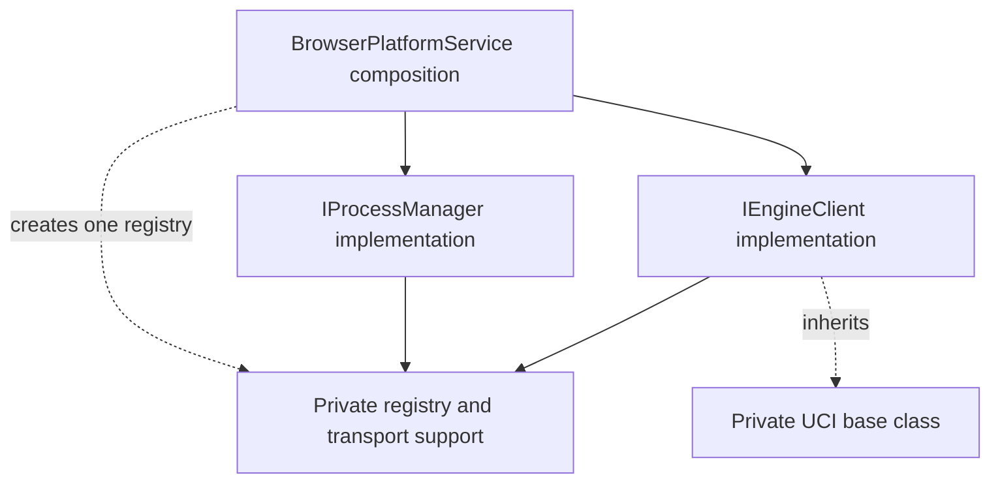

# Browser engine dependency correction

Prepared on 24 October 2026. Status: superseded draft requiring revision after the [NW.js correction and minimal browser reference substitution](NwjsProcessOwnershipFixPlan.md#browser-reference-substitution-only); browser architecture implementation has not started. The native correction and minimal raw-reference substitution are implemented and verified; their results are recorded in the linked plan. Review its revision before implementing the browser correction or resuming the [engine package rework](EngineInstallationReworkPlan.md).

## Shared-process decision supersedes the registry draft

The user's latest direction is to complete NW.js first. For browser compatibility during that step, replace the string handle with the raw Worker reference asserted as the shared IProcess type. Keep the existing browser registry, transport, resolver, composition and lifecycle implementation, changing only identity and necessary contract references. Its process manager and client continue using the existing registry with object keys. See the [explicit boundary](NwjsProcessOwnershipFixPlan.md#browser-reference-substitution-only).

The actual Worker-to-process adaptation and browser dependency correction belong to this separate plan. Their feasibility findings are retained in the [NW.js plan](NwjsProcessOwnershipFixPlan.md#shared-process-feasibility-verified), but that research does not authorise implementing the browser adapter during the native fix.

Verified API constraint: [NW.js exposes Node modules](https://docs.nwjs.io/). Node's [spawn API](https://nodejs.org/api/child_process.html#child_processspawncommand-args-options) returns a ChildProcess object; its [stdin](https://nodejs.org/api/child_process.html#subprocessstdin) and stdout provide the communication streams. The [pid](https://nodejs.org/api/child_process.html#subprocesspid) identifies the process. The documented NW.js/Node APIs do not provide UCI stdin/stdout access from that id alone. The plan must not invent a native send-command-by-pid API.

**The earlier registry-extraction proposal, registry-preservation requirements and registry-based construction/lookup flows below are withdrawn as this browser plan's target design.** They are a superseded draft, not implementation instructions. The native fix intentionally retains the existing browser paths while changing their key identity; this is not approval to extract or redesign them there. The user's inheritance preference remains the direction for keeping browser protocol implementation private. Rebase adapter ownership, platform disposal, failure details and direct runtime access before implementing this browser correction. The adapter must expose only the required process subset and document Worker lifecycle limits; it must not depend on a sibling interface implementation. Do not substitute a renamed lookup registry or introduce an IPC subsystem.

## Preceding NW.js restoration

The user subsequently requested restoring NW.js before this correction. NwjsUciEngineClient now contains its standalone process-based implementation from `cf47d57`, the parent of browser-support commit `78ec6f4`. Retain the later IMoveRaw types and return-type inference cleanup; its emitted JavaScript matches that earlier implementation. Other NW.js modules required no browser-related reversal.

Verification for this restoration: 59 focused tests passed across the NW.js client/process-manager/platform-service, EngineRuntimeService and browser-client suites. The code audit and production build, including TypeScript checks, passed. No EngineRuntimeService or browser source changed. The browser dependency correction below remains unimplemented and must preserve this native restoration.

## Confirmed dependency problem

[BrowserEngineClient.ts](../src/platform/browser/BrowserEngineClient.ts) imports `BrowserEngineRegistry` from [BrowserProcessManager.ts](../src/platform/browser/BrowserProcessManager.ts). The manager exports that type as `Map<ProcessHandle, BrowserUciTransport>`. The client therefore depends on the module implementing its sibling platform interface, including through a type-only import.

The current client resolves communication through the supplied registry; it does not invoke IProcessManager methods. The defect is the shared support being owned/exported by the process-manager implementation. The current UCI factory also receives a transport-resolver callback. Following the user's inheritance preference, replace that injected resolver with a protected hook implemented by the browser subclass, while preserving process and protocol behaviour.

The existing [dependency rules](LowLevel/Architecture/index.md#dependency-rules) allow shared private utilities to behave like imported library code. They must not become public architecture modules or workflow owners. The [EngineClient boundary](LowLevel/Architecture/PlatformAbstraction/EngineClient.md#notes) keeps protocol conversation separate from process lifecycle; [platform composition](LowLevel/Architecture/PlatformAbstraction/PlatformServices.md#notes) wires the implementations together.

## Scope and preservation requirements

Move the existing shared registry/transport support into private utility modules. Convert the browser UCI factory implementation into a private abstract base class, inherited by the concrete browser client. BrowserEngineClient and BrowserProcessManager must neither import the other's implementation nor obtain the other's interface, directly or through a forwarding module or callback into the sibling.

**Only the private inheritance refactor, module moves, import ownership, focused checks and documentation updates explicitly listed here are in scope. Everything else remains unchanged.** Implementation needs a separate instruction to proceed. If another API, ownership or behaviour change becomes necessary, raise it with the user before adding it to this plan or code.

- IPlatformService, IProcessManager and IEngineClient keep their existing methods, signatures and results. EngineRuntimeService requires no source or API changes in this correction.
- Keep defineBrowserUciEngineClientStore(registry), its returned store definition, the browserUciEngineClient store id, registry object identity, process-manager constructor arguments, Worker factory injection and custom engine-services injection. Replace only the internal defineUciEngineClientStore resolver-injection factory with the base/subclass design below.
- Keep Worker construction, URL resolution, handle allocation, command/message handling, error types, promise settlement, stop/restart/disposal and listener cleanup exactly as implemented.
- Keep UCI state transitions, session ownership, option discovery, analysis, player turns and pondering unchanged. Moving the method bodies into a class does not authorise changes to those operations.
- Keep the current EngineClientType.Uci guard, executablePath/protocol fields, bundled Stockfish alias and asset loading. Their proposed changes belong to the later package rework.
- Introduce no new service, platform getter, public registry interface, persistent storage, migration or compatibility export. Update internal imports together; remove the old helper locations rather than retaining forwarding shims.

## Proposed ownership and files

`src/utility/engine` holds private implementation support. TypeScript exports there allow internal imports; they do not add public platform contracts or exports through the platform barrel.

| Existing source | Proposed location/change | Reason |
| --- | --- | --- |
| BrowserEngineRegistry type in BrowserProcessManager.ts | Extract unchanged into `src/utility/engine/BrowserEngineRegistry.ts` | Both implementations import a neutral private support type. Neither owns the shared registry contract. |
| [BrowserUciTransport.ts](../src/platform/browser/BrowserUciTransport.ts) | Move unchanged into `src/utility/engine/BrowserUciTransport.ts` | Worker communication support is shared implementation machinery, separate from the process-manager interface implementation. |
| [IUciTransport.ts](../src/platform/uci/IUciTransport.ts) | Move unchanged into `src/utility/engine/IUciTransport.ts` | Browser transport and its UCI implementation depend on the same private communication shape. |
| [BrowserEngineClient.ts](../src/platform/browser/BrowserEngineClient.ts) | Define an unexported BrowserUciEngineClient subclass of UciEngineClientBase, retaining the existing store-definition factory | Keep the registry field private, override the protected transport hook and bind inherited public methods into the existing Pinia façade. No resolver/service is injected into the base. |
| [BrowserProcessManager.ts](../src/platform/browser/BrowserProcessManager.ts) | Import the registry type and transport from utility locations; remove its registry type export | Preserve all lifecycle implementation bodies. |
| [BrowserPlatformService.ts](../src/platform/browser/BrowserPlatformService.ts) | Import BrowserEngineRegistry from the utility location | Continue constructing one Map and passing that same object independently to manager/client construction. |
| [UciEngineClient.ts](../src/platform/uci/UciEngineClient.ts) | Replace the private factory with `src/utility/engine/UciEngineClientBase.ts`; remove the old factory file after updating its browser importer | Convert existing public operations and private helpers to instance methods. Preserve their meaningful operations, ordering and results. Transport lookup uses one protected abstract hook. |
| [NwjsUciEngineClient.ts](../src/platform/nwjs/NwjsUciEngineClient.ts) | No change in this browser correction | Preserve the restored standalone native implementation and its direct process communication. |
| [BrowserUciEngineClient.spec.ts](../src/platform/__tests__/BrowserUciEngineClient.spec.ts) | Update its registry type import and verify the inherited methods through the existing store façade | Preserve its behavioural assertions and fake Worker; cover method binding without exposing the private concrete class. |

The extracted registry retains its exact shape:

```ts
export type BrowserEngineRegistry = Map<ProcessHandle, BrowserUciTransport>;
```

Its two imported types come from the existing shared ProcessHandle data type and the relocated private transport. It is still a plain Map, with no new wrapper class, singleton, factory or persistence.

IUciTransport retains write and subscribe, and BrowserUciTransport retains its implementation and termination capability. The client consumes communication through IUciTransport; physical Worker termination remains the process manager's responsibility. The utility modules must not import platform implementations, domain services or state stores.

## Private inheritance design

UciEngineClientBase implements the existing IEngineClient contract. Its protocol helpers remain private underscore-prefixed instance methods; the discriminated session still lives on the same assigned-engine runtime. The class introduces no new session table, store or runtime fields.

The only subclass hook is protected transport lookup. It is not added to IEngineClient or any other public interface:

```ts
// Shape only: existing public operation bodies and private helpers are omitted.
export abstract class UciEngineClientBase implements IEngineClient {
  protected abstract _resolveTransport(handle: ProcessHandle): IUciTransport | undefined;
}
// Local to BrowserEngineClient.ts; the concrete class is not exported.
class BrowserUciEngineClient extends UciEngineClientBase {
  constructor(private readonly _registry: BrowserEngineRegistry) { super(); }
  protected override _resolveTransport(handle: ProcessHandle) {
    return this._registry.get(handle);
  }
}
```

The base receives no transport service, resolver callback or process manager. Its private _requireTransport retains the existing handle/error checks and invokes this._resolveTransport(handle). The subclass reads its private registry and returns the existing transport object. The Map supplied to the concrete class is shared resource data, not a sibling service implementation.

Convert the existing factory's operation/helper bodies to instance methods, adjusting owner references to this without changing branching, command order, awaits or settlement. Protocol helpers stay private; only _resolveTransport is protected. Listener and completion callbacks must retain the owning instance when they call private methods.

defineBrowserUciEngineClientStore(registry) remains the browser composition entry point and returns defineStore('browserUciEngineClient', setup). Each store setup constructs one private BrowserUciEngineClient instance and returns the same nine IEngineClient operations as bound methods, satisfying IEngineClient. Explicit binding retains the private instance for inherited prototype methods and Pinia action calls. Do not expose the instance, registry, session or protected hook through the store.

Remove the internal defineUciEngineClientStore(storeId, resolveTransport) factory and its importer. The restored NW.js client remains standalone and does not inherit this base. Keep the current hard-coded Uci assignment guard in this first correction; the later package plan separately changes the enum binding.

## Composition and ownership

This is a dependency diagram, not an execution-flow owner graph. The utility box is private support, not another architectural interface.



Composition creates the registry per existing platform-store instance. The process manager creates and records transports and removes them when they close. The client reads the corresponding transport and owns protocol-session subscriptions. Client stop does not acquire physical Worker ownership; manager shutdown still terminates the Worker and notifies the client through the existing transport events.

Sharing that underlying communication resource is retained. The correction removes the sibling module dependency; it does not add calls between IEngineClient and IProcessManager or a callback that forwards to a sibling method. The browser subclass resolves its transport through the protected override, and the base owns protocol implementation privately.

The NW.js process registry, native process manager and restored native client remain unchanged. The native client has no IUciTransport import to update.

## Function flows to preserve

Use [stacked single-column tables](LowLevel/ProcessFlows/index.md#conventions): one caller per header, direct calls in order beneath it, branches in separate tables. These tables show the proposed private construction and dispatch, alongside the existing Worker lifecycle. The inheritance refactor changes construction and dispatch only; meaningful engine operations, ordering, await boundaries and outcomes must match the current trace.

`IEngineClient implementation: _helper` and `IProcessManager implementation: _helper` identify implementation functions, not additional interface members. Client protocol helpers are private base methods; the one protected hook dispatches to the browser subclass. Base/subclass tables stay within the IEngineClient implementation boundary and do not introduce another workflow owner. Transport utility calls are terminal implementation details. State mutations and error behaviour are described outside the tables.

### Engine composition

Default-services branch of platform-store setup:

| `useBrowserPlatformService setup: engine composition` |
| --- |
| `new Map()` |
| `new BrowserProcessManager(registry)` |
| `defineBrowserUciEngineClientStore(registry)` |
| `invoke the returned Pinia store definition` |

The Map's type import moves to the utility module. The process manager and concrete client receive the same existing object. The manager's default Worker factory and the client's store id remain unchanged.

Existing custom-services branch:

| `useBrowserPlatformService setup: engine composition` |
| --- |
| `new Map()` |
| `new BrowserProcessManager(registry)` |
| `_options.createEngineServices()` |

Preserve the current branch, including construction/disposal of the default browser manager before an override is selected. Do not combine this correction with setup or cleanup optimisations.

| `defineBrowserUciEngineClientStore(registry)` |
| --- |
| `defineStore('browserUciEngineClient', setup)` |

| `browserUciEngineClient store setup` |
| --- |
| `new BrowserUciEngineClient(registry)` |
| `client.awaitPlayerTurnMove.bind(client)` |
| `client.getOptions.bind(client)` |
| `client.initialiseEngine.bind(client)` |
| `client.restartEngine.bind(client)` |
| `client.startAnalysis.bind(client)` |
| `client.startPlayerTurn.bind(client)` |
| `client.startPondering.bind(client)` |
| `client.stopAnalysis.bind(client)` |
| `client.stopEngine.bind(client)` |

Return those bound operations under their existing keys. The private client instance is not returned. Its constructor stores the shared Map privately and calls super() without a service/resolver argument. The existing hard-coded Uci guard is unchanged in this correction.

### Worker creation

| `IProcessManager implementation: spawnProcess(executablePath, args)` |
| --- |
| `_resolveWorkerUrl(executablePath)` |
| `_createWorker(url)` |
| `new BrowserUciTransport(worker, () => this._registry.delete(handle))` |

Preserve rejection of desktop arguments before URL resolution. Preserve the existing handle allocation and registry insertion immediately after transport construction. The close callback deletes that handle from this same registry. Worker/transport construction, returned handle and ProcessStartFailed handling are unchanged; only the utility import locations move.

### Client transport lookup and writes

| `IEngineClient implementation: _requireTransport(processHandle)` |
| --- |
| `this._resolveTransport(processHandle)` |

| `IEngineClient implementation: protected _resolveTransport(handle)` |
| --- |
| `this._registry.get(handle)` |

The first table is the base's private helper; the second is virtual dispatch to the subclass's protected override. Preserve the existing missing-handle check before resolving and InvalidProcessHandle rejection when lookup fails. No process-manager operation is called. Existing initialisation and subscription attachment continue to use this lookup, retaining the same transport object.

| `IEngineClient implementation: _writeCommand(processHandle, command)` |
| --- |
| `this._requireTransport(processHandle)` |
| `transport.write(command)` |

Keep the existing missing-handle check and await. The relocated transport still calls Worker.postMessage and delivers string message lines through its existing subscribed callbacks. Do not change asynchronous boundaries, line splitting, listener identity or UCI command order.

### Physical shutdown and client notification

| `IProcessManager implementation: stopProcess(handle)` |
| --- |
| `_requireTransport(handle)` |
| `transport.terminate()` |

| `IProcessManager implementation: _requireTransport(handle)` |
| --- |
| `registry.get(handle)` |

Keep InvalidProcessHandle rejection when the handle has disappeared. The existing transport termination marks it closed, removes Worker listeners, terminates the Worker, invokes the registry-removal callback, notifies exit listeners and clears listener sets in that order. Repeated termination remains a no-op. Worker error/messageerror and write failures keep their existing termination/error paths.

Restart still awaits stop before spawn; platform disposal still terminates registered transports. Client session cleanup remains unchanged and does not call the manager. No lease, service-worker preparation or package-serving behaviour is introduced by this fix.

## Implementation sequence after approval

1. Extract BrowserEngineRegistry and relocate BrowserUciTransport/IUciTransport without changing their shapes or bodies. Update every source/test importer in the same change; remove the old helper files and manager-owned type export.
2. Convert the browser UCI implementation into UciEngineClientBase with private protocol methods and the protected abstract lookup. Add the local BrowserUciEngineClient subclass and bind its inherited public operations into the existing Pinia store. Remove the old resolver-injection factory. Verify callback instance binding and preserve meaningful operation/await order. Make no changes to the restored native client.
3. Add a focused dependency regression check in `src/platform/__tests__/BrowserEngineDependency.spec.ts`. Reject client-to-manager and manager-to-client dependencies, including type-only imports and re-exports through a barrel. Also reject utility imports of platform implementations. Keep this local to the affected dependency graph, without introducing a repository-wide architecture framework.
4. Run the checks below and compare meaningful source operations before/after. Do not change existing behavioural expectations to accommodate the move.
5. During implementation, update only the affected private-support entries and owner notes in [UtilityIndex](LowLevel/Architecture/UtilityIndex.md), [EngineClient](LowLevel/Architecture/PlatformAbstraction/EngineClient.md) and [ProcessManager](LowLevel/Architecture/PlatformAbstraction/ProcessManager.md). Keep private utilities out of public interface lists and workflow ownership. The baseline low-level documents remain untouched during this planning task.

## Verification and completion criteria

The dependency check must catch the original type-only import, not just runtime calls. It must permit platform composition to import both implementations and permit both implementations to use private utility support. Resolve import targets so an alias or forwarding barrel does not conceal the same dependency. Check that the base has no injected transport/service resolver and that the lookup hook is protected. The concrete client class, registry and hook must not become members of the returned store.

Run these focused suites after implementation:

| Existing suite | Evidence to preserve |
| --- | --- |
| [BrowserUciEngineClient.spec.ts](../src/platform/__tests__/BrowserUciEngineClient.spec.ts) | Bundled handshake/options, analysis/stop, legal player moves, failure rejection, isolated workers/restart, target/argument rejection and ignored output after stop. Exercise inherited public methods through the Pinia façade, including a detached method call, to catch lost instance binding; keep the concrete class private. |
| [BrowserPlatformService.spec.ts](../src/platform/__tests__/BrowserPlatformService.spec.ts) | Composition exposes the existing client/process capabilities and retains disposal behaviour. |
| [NwjsUciEngineClient.spec.ts](../src/platform/__tests__/NwjsUciEngineClient.spec.ts) | Protect the independently restored native handshake, protocol states and stop/replacement behaviour from accidental changes during the browser correction. |
| [EngineRuntimeService.spec.ts](../src/domain/__tests__/EngineRuntimeService.spec.ts) | Existing runtime APIs, option discovery, cancellation and lifecycle continue to work without source changes. |

Run `npm run check:code`, the focused Vitest suites plus the new dependency check, and `npm run build`. Then run the existing real-Worker [browser analysis](../e2e/browser/Analysis.spec.ts) and [browser failure](../e2e/browser/EngineFailure.spec.ts) checks with one worker and no retries. Those exercise actual transport loading and worker isolation; scripted engine journeys alone do not verify the relocated browser transport.

Completion requires no sibling implementation dependency in either direction; no reverse dependency from the utilities into platform implementations; inheritance with private protocol helpers and a protected transport hook rather than resolver/service injection; unchanged public contracts, native client and runtime source; preserved registry/transport identity and execution ordering; and passing focused checks. Only then resume the separately approved package rework when the user explicitly requests implementation.

The browser correction remains a plan, with no executed verification for its proposed moves. Only the preceding NW.js restoration has been implemented and verified as recorded above; it does not resume browser or package implementation.
