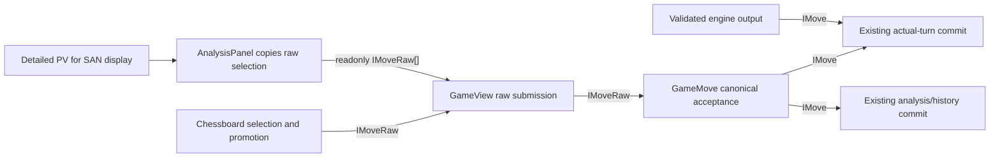

# Raw move submission API design

Proposed on 22 October 2026. **Status: design awaiting approval; no implementation or new test execution.** This specifies PRE-RAW in the [premove plan](PreMovePlan%28ToDo%29.md#pre-raw---pending-move-submission-refactor) and the still-pending [CodexFollowUp item](CodexFollowUp.md#still-pending). It must pass its own tests before premove behaviour starts. Preserve the separately completed [analysis/pause/history decisions](BackgroundAnalysisPlan.md) and [code cleanup rules](CodeCleanupPlan.md).

## Decision and scope

Use existing `IMoveRaw` for board selection, completed promotion and application submission. Convert a validated raw move into `IMove` at canonical acceptance in `GameMoveComposable`, before the existing actual-turn, branch and service calls. Displaying engine analysis can retain detailed moves; selecting that display creates a raw submission.

The conversion boundary is a responsibility in the existing move action, not a new public service or chess utility. Keep action/event names, saved data and actual-turn lifecycle. Choose each move parameter from its consumer: raw submission, existing candidate application, or full transition facts. The retention audit below gives the source-level reason for every full-move boundary. The changes are submission parameter/event types, private view data, the audited application/protocol parameter requirements and where UI enrichment happens. Do not add an input envelope, second raw type, result enum, public batch action, raw-to-detailed cast, `IMove | IMoveRaw` union or separate move/premove utility.

PRE-RAW enables no premoves, speculative candidates, displaced board, queue buttons or queue lifecycle changes. The later premove integration intercepts eligible off-turn raw input before canonical preflight/enrichment and resolves it at its actual due turn. [The queue design](PremoveDataStructure.md) remains a dependent stage.



Detailed preview steps stay local to the detached preview; they are not carried along raw submission arrows. The application delegate only requires `IMoveCandidate`, as audited below.

## Current APIs and problem

Source inspected for this design:

- [Chessboard](../src/components/Chessboard.vue) already selects `IMoveRaw` legal targets, including promotion alternatives. `_emitMove` immediately calls `toDetailedMove`, and `moveAttempted` requires `IMove`.
- [GameView](../src/views/GameView.vue) types board handlers, continuation data, requests and playback as detailed moves. `_applyMoves` validates a full prefix on a copy, enriches every step, then transports that detailed array to the store over time.
- [GameMoveComposable](../src/state/game/GameMoveComposable.ts) accepts `IMove`, selects the actual/analysis/history route and trusts its detail fields.
- [ModalHost](../src/components/ModalHost.vue) has a separate legacy promotion handler that also enriches before calling the store. Its [modal payload/schema](../src/contracts/ModalState.ts) currently requires a detailed move although the chooser only reads coordinates. Apply the same raw-input boundary if retaining this route; do not leave a second UI conversion path.
- [MoveApplicationService](../src/domain/MoveApplicationService.ts) currently requires `IMove` although its rule delegate only reads candidate fields. Narrow its application requirement to existing `IMoveCandidate`. [MoveHistoryService](../src/domain/MoveHistoryService.ts), accepted-turn delivery and engine output retain full moves for the explicit consumers listed below.

An input coordinate tuple describes an intention. Moving colour/kind, capture, castling/en-passant, check, ambiguity and notation describe a transition from a particular board. A delayed raw submission must resolve those facts from its accepted canonical source. Detailed values retained by the board or PV display must not supply them to a different position.

## Data contracts

Keep [Move.ts](../src/contracts/Move.ts) unchanged:

```ts
interface IMoveRaw {
  from: BoardId;
  to: BoardId;
  promotionPiece?: PieceKind;
  $?: IMoveRuntime;
}
interface IMoveCandidate extends IMoveRaw {
  kind: MoveKind;
  movingColour: PlayerColour;
  movingPiece: PieceKind;
  capturePiece?: PieceKind;
}
interface IMove extends IMoveCandidate {
  checkState?: CheckState;
  ambiguityKind?: AmbiguityKind;
}
```

`IMoveRaw` already permits optional runtime `$` for other consumers. Leave that shared contract intact. For a board/PV submission, own only a new `{ from, to, promotionPiece? }` value, omitting absent promotion. Do not transport caller `$`, SAN/UCI caches, ponder replies or supplied detailed fields as authority.

Use raw payloads directly:

```ts
const quiet: IMoveRaw = { from: 12, to: 28 }; // e2-e4
const promotion: IMoveRaw = {
  from: 48, to: 56, promotionPiece: PieceKind.Knight, // a7-a8=N
};
```

No `movingPiece` or moving-colour field is required. Read the source from the selected canonical board; derive all accepted details through existing chess rules. `promotionPiece` remains generic in the interface, with Q/R/B/N, source/rank and required-choice checks performed through legal candidates. Do not introduce a special raw promotion interface or narrow the shared enum.

### Copy and mutation ownership

| Boundary | Ownership |
| --- | --- |
| Legal candidate in Chessboard | Existing rule-derived raw value; selection/promotion never mutates the board or enriches that candidate |
| Board event | Raw coordinate/promotion payload only. Receiver does not mutate it |
| AnalysisPanel selection event | Copy the selected prefix to raw coordinate/promotion values. Detailed display props and their runtime caches stay with the display |
| GameView asynchronous continuation/playback | Copy the raw fields into an owned list before retaining them. Changes to an engine PV array or original payload cannot alter pending input |
| Store acceptance | Read raw fields and match a freshly generated legal candidate. Ignore any extra properties even when a structurally compatible `IMove` is supplied |
| Preview | Detached position plus temporary detailed steps, local to validation. Do not retain these as submitted moves or canonical nodes |
| Actual or analysis commit | Fresh detailed move produced for the accepted canonical source; existing history/application functions retain it under their normal ownership |

Frozen caller inputs must work. No in-place deletion of fields or mutation of `$`. Copy at the producing event boundary and when taking ownership of externally mutable retained input; do not repeatedly clone at each synchronous forwarding hop or export a new generic copy utility. Store resolution from a fresh candidate discards caller metadata without cloning an entire detailed object.

## Public API changes

These are target callable/event contracts, not implementation return annotations. Implementations continue following the project's return-inference rules.

| API | Current | Proposed | Completion/error contract |
| --- | --- | --- | --- |
| `Chessboard.moveAttempted` | `[move: IMove]` | `[move: IMoveRaw]` | Emit once for a completed legal board attempt; no emission for incomplete promotion, cancelled/invalid input or a disabled/replaced owner |
| `GamesStore.makeMove` | `(game: IGame, move: IMove) => Promise<void>` | `(game: IGame, move: IMoveRaw) => Promise<void>` | Same action name and asynchronous routing; reject forbidden/illegal submissions before commit. Preserve existing handler/branch completion, detailed service calls and error presentation |
| `GameMoveComposable.makeMove` | `(game: IGame, move: IMove) => Promise<void>` | `(game: IGame, move: IMoveRaw) => Promise<void>` | Store facade delegates here; this owner classifies context, validates and enriches canonical input |
| `AnalysisPanel.moveSelected` | `[moves: readonly IMove[]]` | `[moves: readonly IMoveRaw[]]` | The event transports a selected prefix; it does not render SAN. Copy coordinate/promotion fields on emission. Detailed PV props remain for rendering |
| Existing Promotion modal payload | `move: IMove` | `move: IMoveRaw` | Its chooser completes raw coordinates with the chosen promotion and submits to the store. Align this transient modal schema with raw board IDs/optional promotion; do not change saved game schemas |

The [audit below](#requirements-narrowed-after-the-audit) also lists the application and ponder/protocol parameter changes: existing names, results, commands and lifecycle stay the same. These are intentional reductions in required input data, not new APIs.

Existing detailed `makeMove` callers remain type-compatible because `IMove` extends `IMoveRaw`. Their extra fields are ignored and regenerated; compatibility does not mean trusting cached details. No overload or union is needed. Consumers listening to the board event must stop assuming it carries `kind`, moving colour/piece or notation facts.

Board props such as `position`, `lastMove?: IMove`, orientation and appearance remain unchanged. `lastMove` is a historical fact used for drawing and legal-query optimisation, not the board's submission type. Board-edit events remain coordinate/piece editing events with their existing signatures; they do not pass through `makeMove`.

## Private API and function changes

| Existing/private owner | Target contract | Behaviour |
| --- | --- | --- |
| `Chessboard.legalMoves` | Computed `IMoveRaw[]` | Existing legal piece query; explicit computed generic where inference needs it |
| `pendingPromotionMoves` | Existing `ref<IMoveRaw[]>` | Hold current raw alternatives outside submitted data |
| `_commitTarget(boardId: BoardId)` | Inferred return | Select one raw candidate, or open the promotion choice; do not enrich |
| `_choosePromotion(move: IMoveRaw)` | Replaces private kind-only parameter | Template passes the exact current candidate. Verify membership in the current pending alternatives and input permission before emission; a detached old choice cannot complete a newer chooser |
| `_emitMove(move: IMoveRaw)` | Inferred return | Emit the raw candidate and clear this board's transient input; remove `toDetailedMove` from Chessboard |
| `inputActions.move` | `(move: IMoveRaw) => existing action result or undefined` | Captured selected-input owner check stays ahead of routing |
| `inputActions.line`, `_playAnalysisLine` | `readonly IMoveRaw[]` | Routing/slicing uses raw coordinates and prefix length only. No detailed fields are consumed, so these adapters do not retain `IMove` |
| `_makeMove(move: IMoveRaw)` | `Promise<void>` by inference | Pass one raw request through the existing view flow |
| `_requestMoves(moves: readonly IMoveRaw[])` | `Promise<void>` by inference | Preserve capability, playback and ordinary-history confirmation gates |
| `pendingContinuation` | `{ game: IGame; node: IMoveNode; moves: readonly IMoveRaw[] }` | Retain owned raw fields and existing selected game/node ownership, with no stale detailed payload |
| `_confirmContinuation()` | Existing inferred asynchronous return | Recheck captured game/node, mode, ongoing result and Takeback permission; then submit retained raw data through the existing action |
| `_applyMoves(game: IGame, moves: readonly IMoveRaw[])` | `Promise<void>` by inference | Preflight the entire canonical prefix on a detached copy; retain raw entries for delayed submission, not the preview's detailed steps |
| `ModalHost._choosePromotion(pieceKind)` | Existing inferred asynchronous return | Build raw from/to plus the choice and call `makeMove`; remove UI-side enrichment. Preserve the existing modal lifecycle and canonical selected-position checks |
| Private `GameMove._resolveMove(position, move, lastMove?)` responsibility | Inputs `IBoardPosition`, `IMoveRaw`, optional canonical parent's `IMove`; inferred `IMove` result or throw | Small private implementation in the existing composable if needed to keep dispatch compact. Match legal raw input, then enrich; no exported resolver/wrapper |

`Chessboard._choosePromotion` receives the selected candidate rather than only a piece kind because the candidate belongs to one current chooser. Reopening promotion creates new alternatives. This is input ownership, with no generated ID, token or sequence counter.

The existing board external-prop observer remains a synchronous transient-input reset. Add `inputDisabled` to its existing `position`/`boardEdit` inputs if needed to cancel a chooser/drag when permission changes without a new board object; update its exact audit-policy entry and reason with the implementation. Do not add another watcher, gameplay effect or modal-completion subscription. Mode/route changes continue cancelling view playback explicitly.

## Type-retention audit and justification

This audit covers the submission, rule/application, accepted-turn, history, PV and engine/protocol boundaries discussed by PRE-RAW. An existing signature, forwarding a value, or receiving a detailed object does not by itself justify requiring `IMove`. The table identifies direct field readers and downstream storage consumers separately. `IMove` is structural data, not proof of legality; validation and source/turn ownership still establish acceptance.

### Full move contracts retained

| Boundary/data | Concrete consumer and required detail | Why retain `IMove`; what raw-only would change |
| --- | --- | --- |
| `MoveNotationUtility.getSan(move)` and SAN rendering in HistoryPanel/AnalysisPanel | `_buildSan` reads `movingPiece`, `kind`, `capturePiece`, `ambiguityKind`, `checkState` and promotion; it has no board parameter | Raw coordinates cannot distinguish Nf3/Nxf3, castling, ambiguity or check suffixes. Making this raw would require a board/replay dependency for every formatted move. Retain the complete transition here |
| `IMoveNode.move`, `MoveHistoryService.addMainlineMove/addAnalysisMove`, `_createChildNode` and `getMoveSequence` | History service stores/returns the same move; history/PV formatting consumes its SAN facts, captured totals use `capturePiece`/`movingColour`, and actual Takeback counting uses historical `movingColour` | The service itself mostly stores/forwards; the justification is its durable node contract and those readers. Saved/root-plus-moves history has no source board per node. Raw storage would require replay before these reads and a separate persistence/model change. Analysis nodes also need detailed notation even though they are not actual moves |
| `_applyLiveMove`, `commitLiveMove` | `_applyLiveMove` passes `movingColour` to clock application and stores the full move with its clock/recorded analysis via `addMainlineMove` | Clock application alone needs only colour, but this operation publishes one complete actual transition to history. Retain the accepted full object so clocks/history agree; do not perform a second raw enrichment inside the commit stack |
| `_advanceRenderedAnalysisBranch`, `_commitLiveAnalysisMove`, `_commitStandaloneAnalysisMove` | Application uses candidate fields; `addAnalysisMove` retains full transition facts for the selected branch and SAN | These are post-acceptance branch mutation operations. The full requirement comes from the history sink, not from path/state updates. Raw user input is resolved before reaching them |
| `_commitHistoryRewriteMove` | Passes the accepted selected-parent transition to `_applyLiveMove`, then clocked actual history | It does not independently read every detail. Retain a resolved move paired with the captured canonical parent, validate before cancelling old actual work, and recheck parent/result ownership after settlement. Raw would move conversion into this awaited mutation path; there is no benefit in converting twice or deriving against a changed source |
| `GamePlayerTurn.attemptPlayerMove`, current `Deferred<IMove>`/held output and later accepted `playerTurn.move` | Delivery itself resolves/stores a value; its consumer is the detailed actual commit above | This is accepted current-turn work, distinct from a UI proposal or raw premove queue. Retaining the resolved transition preserves the facts accepted for its owned parent while paused and sends it to commit once. A raw-only owner would have to repeat/move enrichment at delivery. The type alone does not protect ownership |
| `IEngineClient.awaitPlayerTurnMove`, UCI parsed/result completion data, `EngineRuntimeService.awaitPlayerTurnMove` result and `startPlayerTurn` delivery callback | Engine client produces an enriched move for the searched board; runtime validates it and forwards it to the same clock/history consumer | Retain the already-resolved transition through this provider path. Returning raw instead would relocate the existing engine conversion/consumer boundary. This is not because UCI coordinates or the legality predicate require full moves: those already use `IMoveRaw` |
| `IAnalysisLine.pv` and copied recorded PVs | `AnalysisPanel` renders `getSan` per PV step without a board for each predicted position; recorded analysis serialises those complete move facts | Retain detailed display/record data. The selected-prefix event is a separate raw submission. Replacing the display with raw would require replaying PV source boards for notation and changing recorded-analysis schemas |
| `IEngineAnalysisUpdate.bestMove`, `IAnalysisSeat.bestMove`, `_buildAnalysisUpdate` and their recorded schemas | Update/seat assignment forwards the engine result; `createAnalysisSeatSchema(moveSchema)` records the full result alongside the detailed PV | This is schema/representation compatibility, not a direct SAN requirement for `bestMove`: the panel currently formats PVs. Keep one engine-result representation and the existing saved-analysis schema. A raw-only best-move field is possible but would be a separate model/schema migration, with no benefit to board submission |
| `IMoveRuntime.ponderMove` produced by `_parseDetailedBestMove` | The parser uses `genDetailedMoves` for the best move and its reply; these are enriched engine-result data | Keep that produced result representation and shared `Move.ts` contract; do not strip it from accepted output. Ponder commands consume only raw fields, as narrowed below. The presence of this metadata is not a reason to require `IMove` on their inputs |
| `Chessboard.lastMove`, private resolver's canonical `lastMove`, and `genLegalMovesForPiece(..., lastMove?)` | The legal query reads `movingColour` to establish the previous opposing mover and `checkState` for check/checkmate fast paths | Highlighting alone needs only from/to. The same existing last-move input also feeds this rule optimisation. Retain its historical full move; raw-only would require removing that optimisation or recomputing attacks, not adding another source-of-truth prop |
| `toDetailedMove` result, `genDetailedMoves`/existing detailed legal enumeration results and canonical `_resolveMove` result | Their purpose is to produce the SAN/history/commit facts consumed above | These are conversion outputs, not proposal inputs. Keep `IMove` as the result; raw target/legality APIs already cover callers that need only coordinates |

Runtime `$`, cached UCI and a ponder reply do **not** independently justify full moves: `IMoveRaw` already permits `$`. Preserve existing engine metadata/ownership because its path is already accepted provider work, not because the raw interface cannot carry it. Equally, `Promise`/deferred storage alone does not require a full move; the accepted commit consumer is the reason for that specific storage contract.

Source references for the retained consumers: [notation](../src/utility/chess/MoveNotationUtility.ts), [history storage](../src/domain/MoveHistoryService.ts), [commit/Takeback](../src/state/game/GameMoveComposable.ts), [capture display](../src/views/GameView.vue), [turn ownership](../src/state/game/GamePlayerTurnComposable.ts), [engine results](../src/platform/uci/UciEngineClient.ts), [analysis schemas](../src/contracts/AnalysisSeat.ts), and [last-move rule optimisation](../src/utility/chess/GameRuleUtility.ts).

### Requirements narrowed after the audit

| API | Proposed type | Source-level justification |
| --- | --- | --- |
| `AnalysisPanel.moveSelected` | `[moves: readonly IMoveRaw[]]` | Selection only emits a prefix. `getSan` runs on the separate detailed `line.pv` props; it does not justify a detailed event |
| `GameView.inputActions.line`, `_playAnalysisLine` | `readonly IMoveRaw[]` | Only choose/slice/route a prefix. No full-move field reader; accept the raw event directly |
| Promotion modal payload/schema and `ModalHost._choosePromotion` submission | `IMoveRaw` | Reads from/to and adds the explicit promotion choice. No full fields are read; conversion belongs to canonical store acceptance |
| `GameRuleUtility.applyMove(position, move)` | `(IBoardPosition, IMoveCandidate) => IBoardPosition` | Current application reads `kind` for castle/promotion/castling-right handling and `movingPiece` for the double-pawn en-passant target. It reads neither `checkState` nor `ambiguityKind`; full `IMove` is not required |
| `MoveApplicationService.applyMove(position, move)` | `(IBoardPosition, IMoveCandidate) => IBoardPosition` | Delegates to that rule function; no independent full-move reader |
| `MoveApplicationService.genPosition(root, moves)` | `(IBoardPosition, readonly IMoveCandidate[]) => IBoardPosition` | Replays through candidate application. A stored `readonly IMove[]` remains assignable; replay does not use SAN/check/disambiguation |
| Private rule application helpers | `IMoveCandidate` where application facts are read; keep `IMoveRaw` where only coordinates are read | Audit `_updateCastlingAvailability_`, `_isMoveEnpassantTarget`, `_updatePositionAfterMove` and `_applyCastleMove` with `applyMove`. Do not retain full input merely because the caller has it |
| `EngineRuntimeService._canPonder`, `_isMoveSequenceLegal` | `IMoveCandidate` / `readonly IMoveCandidate[]` | Replay through application plus raw legality checks; neither helper formats or stores detailed facts |
| `EngineRuntimeService.startPondering`, `IEngineClient.startPondering`, UCI client implementation and session `expectedMove` | `IMoveRaw` for each move input | Forward/build coordinate commands and compare the expected reply. No SAN/history field consumer; existing enriched engine replies remain assignable |
| `UciUtility.buildFindNextMoveCommands` optional expected move, `buildPonderMoveCommands`, `isPonderHit`, `_movesMatch`, `_buildPositionCommand` and private path-move lists | `IMoveRaw` / `readonly IMoveRaw[]` as applicable | [Current implementation](../src/utility/UciUtility.ts) uses from/to/promotion and existing raw `buildUciMove`. Reduce the declared requirement without copying history objects, changing commands or changing the ponder lifecycle |

`IMoveCandidate` already exists; no new subset interface/alias is introduced. Since the extra `IMove` fields are optional, candidate-only objects are already structurally assignable today. These annotation changes state the actual dependency; they do not establish a new runtime behaviour or a separate behavioural red test. `genNextPosition(position, move: IMoveCandidate)` already exposes this application level. Candidate application does not promise full legality: the acceptance path still validates first. A complete `IMove` is a candidate subtype, so actual/analysis commits can pass the same enriched object to application and history without conversion or extra copies.

This is an explicit parameter-requirement adjustment, not a claim that full moves are essential to board application. Application could consume `IMoveRaw` if it derived its currently supplied `kind`/`movingPiece` inside the rule algorithm. That is a different algorithm boundary; this proposal keeps existing application mechanics and uses their existing least applicable named contract. It does not derive check/ambiguity just to move a piece. A narrower custom `Pick`/new interface is unnecessary.

UCI coordinate builders/formatters (`buildUciMove`, `getUci`), raw legal targets, matching and submission retain `IMoveRaw`. No detailed fields are needed for those operations. Existing history and engine-client schemas keep their names/shape; the application methods above keep names/behaviour but receive the documented candidate parameter type.

## Rule API use and acceptance algorithm

No new public rule function is required by PRE-RAW. Apply the audited candidate parameter adjustment to existing board application; keep these legal-query/enrichment signatures:

```ts
genLegalMovesForPiece(position: IBoardPosition, from: BoardId, lastMove?: IMove): IMoveRaw[];
isMoveLegal(position: IBoardPosition, move: IMoveRaw): boolean;
requiresPromotionSelection(position: IBoardPosition, move: IMoveRaw): boolean;
toDetailedMove(position: IBoardPosition, move: IMoveRaw, legalMoves?: IMoveRaw[]): IMove;
```

`toDetailedMove` enriches; it does not establish legality by itself. At canonical acceptance:

1. Run existing mode/permission checks and identify the owned canonical parent/position for this route before touching history, clocks or current-turn delivery.
2. Check that `from` and `to` are integer board IDs in `0..63`. Use the real position; never change its `sideToMove` to make input legal.
3. Query legal candidates for that source with this canonical parent's last move, then match `to` and exact `promotionPiece`. Missing required promotion, an extra promotion on a normal move, King/Pawn promotion, empty/opponent source or otherwise illegal input has no match and rejects.
4. Call `toDetailedMove(position, matchedCandidate)` for a fresh `IMove`. Do not pass the caller's object. Leave the optional third argument omitted unless supplying the complete board-wide legal candidate set: a selected-piece-only set would lose other-piece SAN disambiguation.
5. Call the existing detailed actual/analysis/history route. Resolve before an invalid history request can cancel the actual provider or rewrite clocks/selectors. At existing awaited rewrite boundaries, preserve/recheck ownership of the accepted selected parent and ongoing result before canonical mutation.

Normal selected/live position references may alias by design; explicit analysis with equal-valued paths has its independent canonical cache. Parent node and position must come from the same selector. In particular, do not use the live last move to optimise a historical/analysis legal query.

Rule queries may retain their existing runtime memoisation, but a rejection creates no persisted chess/tree/clock change. It cannot add a node, increment time, record analysis, trigger an autosave move count, restart a provider or revive a terminal game. Do not replace established error handling with a new error taxonomy; the view's existing `_run` presents rejected action errors.

## Mode and source matrix

| Context | Canonical acceptance source | Route/result |
| --- | --- | --- |
| Ordinary following-live local turn | Actual live parent/position, which selection follows | Validate/enrich, then existing `attemptPlayerMove`; actual effects once |
| Engine due in PRE-RAW | No manual actual move accepted | Preserve existing rejection; do not enable off-turn queuing in this stage |
| Explicit in-game analysis, including a genuinely paused game | Selected canonical parent/position | Detailed analysis branch move only; actual board/clock/held output remain independent |
| Free/post-result exploration | Selected canonical parent/position | Existing standalone analysis route; never revive actual play |
| Ordinary historical continuation, Takeback allowed | Confirmed selected historical parent/position | Existing confirmation, cancellation of actual work and actual rewrite with preserved variation/clock policy |
| Historical input without Takeback permission | None until explicit Analyse | Preserve rejection/disabled input; do not reinterpret it as live input |
| Ordinary actual play under Manual/Menu pause | None | Reject new actual input; no implicit Resume |
| Board edit | Existing piece-edit APIs | No move submission/enrichment |
| Hotseat | Newly due actual side's current owner | Same raw path; old captured side callbacks remain ineffective |

Source piece colour is derived from the source position and existing seat permission. A raw tuple cannot prove which earlier position a caller had in mind if that tuple is also legal now. The originating view must reject obsolete captured callbacks; a new direct store call is interpreted against current canonical state. Do not add provenance fields to `IMoveRaw` to duplicate this ownership.

## Function flows

### RAW-F01 - Normal click, drag or keyboard move

`select source -> existing legal raw targets -> target -> _emitMove(raw) -> captured view action -> _requestMoves([raw]) -> canonical preflight -> GamesStore.makeMove(raw) -> GameMove validation/enrichment -> existing detailed actual/analysis route`.

Board target highlighting and source/target semantics remain the same. The payload change is observable before store execution. The view does not attach `movingColour`, `movingPiece`, check/capture facts or `$` to the submitted value. A legal ordinary action causes one existing move transition; PRE-RAW adds no second turn or commit callback.

### RAW-F02 - Promotion and chooser replacement

`pawn target -> multiple raw promotion alternatives -> hold current alternatives -> select exact candidate -> verify current chooser/input -> emit completed raw candidate -> canonical exact-promotion validation -> enrichment`.

No move emits while a choice is incomplete. Cancel clears that attempt. Position, mode or input-permission replacement clears transient input. A retained old choice is absent from a new pending array and cannot select the same kind for that replacement. All Q/R/B/N quiet/capture promotions use the same API, with no queen default.

### RAW-F03 - PV display, preflight and delayed playback

`AnalysisPanel detailed display -> raw selected-prefix event -> existing context policy -> _requestMoves(raws) -> _applyMoves -> preflight whole prefix on detached canonical board -> owned raw playback -> makeMove(current raw) at each step`.

For preflight, validate each raw step and advance that private preview through candidate application. Existing `toDetailedMove` may supply that candidate; any extra check/ambiguity details it computes stay temporary. If any later step is invalid, submit nothing. Retain the copied raw list for playback. Every actual submission is re-resolved against its current accepted canonical source, never using the preview's stale capture/check/ambiguity data.

Keep the existing first-move policy in ordinary play and full-prefix exploration policy in explicit/free analysis, including visibility preferences. The later premove route can identify the clicked mover from the captured canonical PV source side and selected-prefix length: odd length is that side, even length is its opponent. Check that mover against the local seat before taking the final raw entry. Do not recover it from caller metadata or a source square on the displaced display, and never enqueue the preceding replies. Keep the existing delay, `OperationOwner`, expected path/mode/game/result/permission checks and cancellation handling. Cancellation after one committed step does not undo that step; it prevents the suffix. Unrelated scores behind the same selected board do not invalidate valid input.

### RAW-F04 - Historical confirmation

`ordinary selected history -> raw continuation retained with game/node -> Cancel or Confirm -> context recheck -> raw canonical validation/enrichment -> existing detailed history-rewrite action`.

Cancel/stale confirmation produces no store move. A fresh valid confirmation still changes actual play only when Takeback is allowed and actual play is unpaused/ongoing. Validate raw legality before aborting actual work; the rewrite continues protecting its accepted selected parent and checks whether actual play ended during settlement. Preserve the old continuation and existing clock restart policy. Explicit Analyse bypasses this modal and never rewrites actual play.

### RAW-F05 - Engine, pause and completion

`EngineRuntimeService validated IMove -> captured existing player-turn delivery -> existing detailed commit or held paused output` remains unchanged in PRE-RAW. Do not route engine results through the new board-raw adapter, strip their ponder metadata or restart their search.

The public return type stays `Promise<void>`. Preserve its existing waits rather than adding fire-and-forget delivery or waiting for analysis evaluations:

| Submission | PRE-RAW completion |
| --- | --- |
| Ordinary unpaused local move | Await the existing current-turn handler as today; normal completion has committed its node/clock effects |
| Analysis/confirmed history mutation | Complete the existing branch/rewrite action; do not wait for later engine evaluation |
| Invalid/forbidden input | Reject before move acceptance; existing view error handling presents it |
| Replaced captured view input or cancelled confirmation | Existing view no-op; do not submit a replacement move |
| Genuine pause racing already-accepted actual input | Preserve existing deferred-output semantics, without implicit Resume or a second delivery. The current handler can complete after retaining output; PRE-RAW does not promise a new actual-commit completion mechanism for that race |

The later PlayerTurn ownership stage in the premove plan explicitly consolidates deferred/commit completion. Do not fold that lifecycle refactor into PRE-RAW merely to change a parameter type. Test the pause race separately so raw API migration does not accidentally lose output or claim a stronger completion guarantee than the current implementation.

## Failure and compatibility examples

| Input/event | Required behaviour |
| --- | --- |
| `{ from: 12, to: 28 }` in the initial White position | Accept raw e4, derive White/Pawn/normal and actual check/notation, create the normal node/effects once |
| Same coordinates with forged capture/check/colour or stale `$` | Ignore extras, resolve from the canonical board; stored fields/caches cannot come from that payload |
| White source submitted while Black is due | Reject through canonical source/seat checks; do not flip the board's side or claim an engine turn |
| Non-integer/out-of-range IDs, empty source, friendly target or opposing king capture | Reject without a canonical move or provider disruption |
| Promotion rank without a choice or with King/Pawn | Board emits nothing while choosing; direct invalid raw action rejects. No implicit queen |
| Castling/en-passant/ambiguous raw move | Existing legal rules and actual source produce the rook relocation/victim/disambiguation; no extra raw metadata |
| Valid first PV step followed by an illegal step | Full preflight rejects before any live/analysis step is committed |
| Source/mode/game replacement after preflight or confirmation | Existing owner cancels/rejects obsolete submission; completed earlier steps stay history |
| Old selected node still has the same path values as live | Respect independent analysis ownership/caches; equal coordinates/path values do not select the live board implicitly |
| Existing detailed history/engine/commit caller | Still passes its full move. Candidate application accepts that subtype, while history retains its complete facts. No saved schema change |

## Tests-first acceptance and migration

The [parent PRE-RAW matrix](PreMovePlan%28ToDo%29.md#pre-raw-tests-before-implementation) retains RAW-S01-RAW-S10. Implement those tests before changing production code:

| Test owner | Cases and observable assertions |
| --- | --- |
| [Chessboard.spec.ts](../src/components/__tests__/Chessboard.spec.ts) | RAW-S01/02: quiet/capture and promotion event payloads are exactly raw; no event before choice/after Cancel; click/drag/native activation in both colours/orientations; detached choice and permission replacement cannot emit |
| [GameView.spec.ts](../src/views/__tests__/GameView.spec.ts) | RAW-S03/07/08/09: raw store payloads from board and detailed PV display, owned/copy-isolated continuation data, full-prefix rejection before first call, delayed suffix cancellation and stale callbacks. A store spy is appropriate for payload delegation assertions |
| Mounted existing Promotion modal and its UiState payload/schema | RAW-S02 variant: accept raw coordinates without detailed fields, complete the explicit choice and send raw to `makeMove`; Cancel sends nothing. Keep this legacy route compatible without adding an opener or a new promotion UI |
| Store/background-analysis tests with real chess rules | RAW-S04/05/06/10: direct raw actions produce correct detailed nodes, exact SAN/capture/check/promotion facts, single clock/recording/autosave effects, unchanged actual board during exploration and all existing pause/result/history/seat boundaries |
| Existing rule/notation/persistence/engine tests | Candidate-only application without check/ambiguity and raw ponder commands retain existing behaviour; retained SAN/history/clock/last-move consumers prove their full-field requirements. Actual legal generation and enrichment remain correct for castling, en passant, ambiguous moves and all promotions. Frozen input/canonical comparisons and supplied-metadata tests prevent using the caller as detailed authority. Engine and saved shapes remain compatible |
| Existing Promotion, Analysis suggestion/playback, History rewrite and Play journeys | Real focus/keyboard/drag/chooser behaviour, historical confirmation and playback cancellation; unit activation alone is not browser keyboard/focus evidence |

Fixture payloads use bare coordinates/promotion choice. Use ordinary canonical board/history data and controlled external providers/time. Include initial e2-e4, a legal e5xd6 en-passant history, a clear castling position with rights, all quiet/capture promotion choices and a two-piece ambiguity fixture. Assert both changed state and important untouched state; no test-side move dispatcher or queue algorithm.

Migration order after approval:

1. Add/adjust raw board/PV/modal event and application-acceptance assertions; record meaningful failures from board enrichment, detailed view transport and raw store incompatibility. A compilation error alone does not establish behavioural red evidence.
2. Change Chessboard/PV event emission and promotion candidate ownership; migrate GameView handlers, raw copying, confirmation and playback data. Align the legacy promotion modal payload/schema/handler with the same raw boundary, without adding another promotion flow. Update the existing observer policy only for the narrowly justified input-permission boundary.
3. Widen the existing store/action parameter; resolve canonical raw legality/details privately before the existing detailed commit routes. Keep engine result/history contracts and actual-turn scheduling intact; align application/validation helpers with `IMoveCandidate` and ponder/protocol inputs with `IMoveRaw` as audited. These type requirements do not change rule algorithms, UCI commands or engine lifecycle.
4. Update existing tests/callers that assumed detailed board emissions. Detailed PV/history display and accepted commit fixtures stay where their audited consumers require them. Add candidate-only application fixtures without check/ambiguity; do not mechanically replace every `IMove` reference.
5. Pass RAW-S01-RAW-S10 and affected existing regressions, then `npm run check:code`, type checks/build and relevant browser gestures. Record exact runs and limits; leave the source follow-up pending until this stage passes.
6. Only then migrate the raw premove FIFO/test fixtures and record a separate failing premove baseline. Implement speculative candidate generation, queue ownership/drain and projected presentation under their own plan stages.

With implementation, reconcile the owning [Chessboard architecture](LowLevel/Architecture/Presentation/Components/Chessboard.md), [move model](LowLevel/Architecture/DataInterface/Move.md) and [GamesStore API](LowLevel/Architecture/StateManagement/GamesStore.md). Their current descriptions include detailed board submissions and the older UCI-only description of raw input; do not silently treat them as already migrated. Update the source follow-up's status only against actual passing evidence.

## Scope and completion checks

PRE-RAW is complete when board/legal-promotion submission and delayed view data use existing `IMoveRaw`, canonical acceptance supplies correct `IMove` details, obsolete input cannot cross its owner boundary, history/notation retain full facts and application accepts candidate facts, and the tests-first/refactor/regression evidence is recorded. Existing analysis while paused, live background play, historical confirmation, branch retention and actual Takeback decisions stay intact.

No queue cap, timing deduction, persistence change, new mode/button, generation counter or additional orchestration watcher is approved by this design. The premove plan still owns all 14 queue flows and 25 premove scenarios; this prerequisite supplies the input API they depend on. This document records design, not implementation approval or passing execution.
